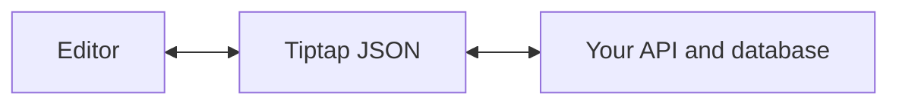
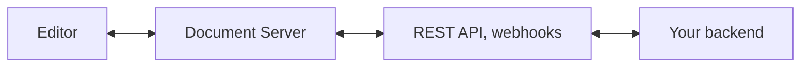

## One document, several ways in

The same document serves people, applications, and agents. Each works with it through its own interface.

| Interface | Used by | What it does |
| --- | --- | --- |
| [Editor](/editor/getting-started/overview) | People | Renders the document and lets people write, format, and review it. |
| [Tiptap JSON](/editor/core-concepts/persistence), the [REST API](/collaboration/documents/rest-api), and [webhooks](/collaboration/core-concepts/webhooks) | Your application and backend | Reads, stores, exports, and changes the content, and tells your backend when it changes. |
| [AI Toolkit](/ai/ai-toolkit/overview) | AI agents | Gives agents tools that read and edit the document's structure instead of raw text or HTML. Their edits can wait for review as [tracked changes](/ai/ai-toolkit/agents/tracked-changes). |
| [Collaboration](/editor/extensions/functionality/collaboration) with the [Document Server](/collaboration/getting-started/overview) or [Hocuspocus](/hocuspocus/getting-started/overview) | Everyone editing at once | Keeps every copy of the document in sync, also offline. |

All interfaces share one [schema](/editor/core-concepts/schema). It defines which nodes and marks a document may contain, and comes from the extensions you choose.

## Tiptap JSON

Tiptap JSON describes the document tree: its nodes, marks, attributes, and text.

```json
{
  "type": "doc",
  "content": [
    {
      "type": "paragraph",
      "content": [{ "type": "text", "text": "Hello world" }]
    }
  ]
}
```

- It shows what is in the document right now.
- It suits APIs, your own database, backups, exports, rendering, and agents.
- `editor.getJSON()` returns it, and `editor.commands.setContent()` loads it.

## Where the document lives

### In your application

The editor holds the document, and your application stores it as JSON.



[Persistence](/editor/core-concepts/persistence) shows how to save and restore the JSON.

### On the Document Server

When several people edit at once, the document lives on the [Document Server](/collaboration/getting-started/overview). Each editor connects to it with the [Collaboration extension](/editor/extensions/functionality/collaboration) and a provider, and changes reach everyone in real time, also after working offline.



Your application still works with Tiptap JSON:

- The [REST API](/collaboration/documents/rest-api) reads documents as JSON, creates them from JSON, and changes them while people edit.
- [Webhooks](/collaboration/core-concepts/webhooks) tell your backend when a document changes.
- [Snapshots](/collaboration/documents/snapshot) keep versions, and [Comments](/comments/getting-started/overview) are stored with the document.
- The [AI Toolkit](/ai/ai-toolkit/agents/streaming) edits the document on the server and streams its edits to everyone who has it open.

The Document Server runs in [Tiptap Cloud](/hosting/cloud) or [on-premises](/hosting/on-premises).

### On Hocuspocus

[Hocuspocus](/hocuspocus/getting-started/overview) is the open source server for real-time editing. You run it and add storage, authentication, and an API yourself. [Hosting](/hosting) compares it with the Document Server.

## Under the hood

Real-time editing is built on [Yjs](https://github.com/yjs/yjs), a shared data type that merges changes from many people without conflicts. On the Document Server you don't handle it: you read and write Tiptap JSON. It matters when you run Hocuspocus or store collaborative documents yourself:

- Store the Yjs updates, not only JSON. Rebuilding a collaborative document from JSON on every connection duplicates content. See [persistence in Hocuspocus](/hocuspocus/guides/persistence).
- Clients on different schema versions drop content the other side doesn't know. Handle it with [invalid schema handling](/editor/guides/invalid-schema).
