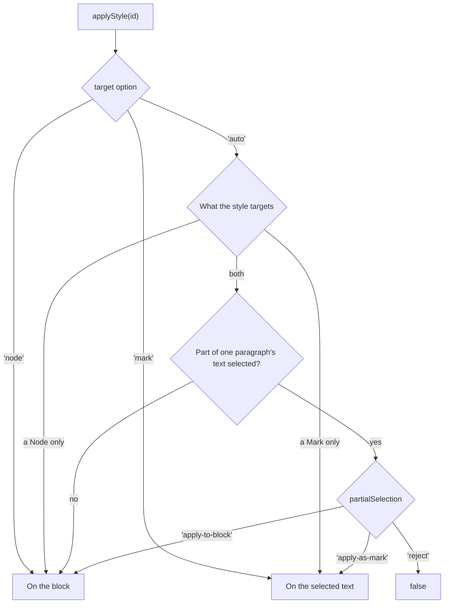

{/* Synced from ueberdosis/tiptap-pro packages/extension-document-styles/docs/applying.md. Change it there and sync it again: an edit made here is overwritten by the next sync. */}

```js
editor.commands.applyStyle('heading-1')
editor.commands.setStyleOverride('color', '#c00')
```

## A style on a block or on text

- **A paragraph style** goes on the block the cursor is in, or on every block the selection
  touches.
- **A quote and the paragraph inside it.** The style goes on the paragraph, as long as both types
  are in `types`.
- **A character style** goes on the selected text, as a Mark of the first type its `targets`
  name, or of the first in `markTypes`.
- **With nothing selected**, a character style goes on the text typed next.
- **The Mark's other attributes stay.** A `textStyle` that has a color keeps it.
- **Overrides go.** Applying a style takes the block's overrides off: it looks as the style says.
- **Character styles in selected text go.** A block style applied with text selected also takes
  the character styles off that text, since they would still win over it where they lie. What
  else such a Mark carries stays, and so does what was overridden on it by hand.
- **With only the cursor in the block**, the character styles in it stay, as in Word.

A style whose `targets` name both a Node and a Mark decides by the selection:



The `partialSelection` option decides for part of a paragraph's text:

| `partialSelection` | What `applyStyle` does                  |
| ------------------ | --------------------------------------- |
| `'apply-as-mark'`  | The default. The selected text gets it  |
| `'apply-to-block'` | The paragraph gets it anyway            |
| `'reject'`         | Nothing happens, and it returns `false` |

One "Style" menu that lets the selection decide is `target: 'auto'`. A "Paragraph style" and a
"Character style" menu are `target: 'node'` and `target: 'mark'`.

### A style that wraps its blocks

A style whose `node` is a type that holds blocks, such as `blockquote`, wraps the selected blocks
in one of it when `transformNode` is on. The style goes on that Node.

```js
editor.commands.setStyleDefinition({
  id: 'quote',
  name: 'Quote',
  kind: 'paragraph',
  targets: [{ kind: 'node', types: ['blockquote'] }],
  node: { type: 'blockquote' },
  props: { fontStyle: 'italic', paddingLeft: 16 },
})

editor.commands.applyStyle('quote', { transformNode: true })
```

- **The wrapped blocks** lose their own styles and keep their overrides.
- **A block style of another `node`** applied to a block inside it takes that block out of the
  blockquote. Where the block was in the middle, the blockquote is split.
- **`removeStyle`** takes every block out of it.
- **A blockquote that no style made** stays where it is.

## A style nothing defines

`onMissingStyle` decides what `applyStyle` does with an id nothing defines:

| `onMissingStyle`       | An id nothing defines                                                  |
| ---------------------- | ---------------------------------------------------------------------- |
| `'preserve-reference'` | The default. Applied all the same, and drawn once something defines it |
| `'fallback'`           | Applies `fallbackStyleId` instead, or returns `false` without one      |
| `'remove'`             | Takes the style off the selection                                      |

## Overrides

What one block or run of text sets apart from its style is stored in its `styleOverrides`:

```js
editor.commands.setStyleOverride('color', '#c00')
editor.commands.unsetStyleOverride('color')
editor.commands.clearStyleOverrides()
```

- **Where they act.** On the selected text where part of a paragraph is selected and the text
  has a styled Mark. On the block otherwise.
- **A style with `autoUpdate`** takes the value into the style instead. See
  [Updating automatically](/editor/extensions/functionality/document-styles/definitions#updating-automatically).
- **Detaching.** `detachStyle({ keepFormatting: true })` takes the style off and writes every
  value it gave as an override, so a later change of the style no longer reaches it.

## Tiptap's own formatting and overrides

Tiptap's formatting Extensions, such as Color, Bold and TextAlign, write formatting of their own.
Two Commands move it into overrides and back. Which Extensions count is in
[Tiptap's own formatting](/editor/extensions/functionality/document-styles/values#tiptaps-own-formatting).

- **`adoptDirectFormatting`** turns it into overrides of the style. A `setColor` and a Bold
  become `{ color: '#c00000', fontWeight: 700 }` on the text's `textStyle`, and the Bold Mark
  comes off.
- **`expressAsDirectFormatting`** is the way back. The overrides are written as Color's attribute
  and a Bold Mark.
- **The text is drawn as before** either way.
- **Why adopt.** The formatting is then in one place, where the theme,
  [dark mode](/editor/extensions/functionality/document-styles/themes#dark-mode), `clearStyleOverrides` and `updateStyleFromSelection` reach it.
- **Why express.** Before handing the document to something that knows Tiptap's Marks and nothing
  of overrides.

`clearInlineStyles()` takes it off altogether, as Word's _Clear character formatting_ does. It
also takes off every character style and every override of the selected text.

## Reading the style of the selection

What a style picker shows is in the attributes, as for any attribute in Tiptap:

```js
editor.getAttributes('paragraph').styleId
editor.isActive({ styleId: 'heading-1' })
```

With the cursor in a table cell, the selection's style is the paragraph's. See
[The cursor in a cell](/editor/extensions/functionality/document-styles/tables#the-cursor-in-a-cell).

## Commands

Every Command is one step of the history. `editor.can()` tells a toolbar which of them apply.

### applyStyle

Puts a style on the block at the selection, or on the selected text.

```js
editor.commands.applyStyle('heading-1', { target: 'node', transformNode: true })
```

| Argument                | Type                         | Description                                                                                                                 |
| ----------------------- | ---------------------------- | --------------------------------------------------------------------------------------------------------------------------- |
| `styleId`               | `string`                     | The style                                                                                                                   |
| `options.target`        | `'auto' \| 'node' \| 'mark'` | Where a style that can be both goes. Default `'auto'`                                                                       |
| `options.transformNode` | `boolean`                    | Also turns each selected text block into the style's `node` type, or wraps the blocks in it. Default `transformNodeOnApply` |

Returns `false` where nothing in the selection can carry the style: a type not in `types`, no
Mark type to use, a `target` the style cannot take. Also with `partialSelection: 'reject'`, and
for `onMissingStyle: 'fallback'` without a fallback that exists.

### removeStyle

Takes the style and every override off the selection.

```js
editor.commands.removeStyle()
```

With `transformNodeOnApply`, a blockquote that a style made is removed, and the blocks it held
stay in its place. Returns `false` where nothing changes, such as a block with no style and no
override.

### setStyleOverride

Sets one value of the selection apart from its style.

```js
editor.commands.setStyleOverride('color', '#c00')
```

| Argument | Type         | Description                             |
| -------- | ------------ | --------------------------------------- |
| `prop`   | `string`     | A CSS property in camel case            |
| `value`  | `StyleValue` | `string`, `number`, `boolean` or `null` |

Returns `false` where the selection has no block or Mark a style can go on.

### unsetStyleOverride

Takes one override off, so the value is the style's again.

```js
editor.commands.unsetStyleOverride('color')
```

| Argument | Type     | Description                  |
| -------- | -------- | ---------------------------- |
| `prop`   | `string` | A CSS property in camel case |

Returns `false` where the selection does not override `prop`.

### clearStyleOverrides

Takes every override off, so the selection looks as its style says.

```js
editor.commands.clearStyleOverrides()
```

Returns `false` where the selection overrides nothing.

### detachStyle

Takes the style off the selection.

```js
editor.commands.detachStyle({ keepFormatting: true })
```

| Argument                 | Type      | Description                                                                                                                               |
| ------------------------ | --------- | ----------------------------------------------------------------------------------------------------------------------------------------- |
| `options.keepFormatting` | `boolean` | Writes every value the style gave as an override, so it looks the same. Default `false`: the overrides it had stay, the style's values go |

Returns `false` where the selection has no style.

### clearInlineStyles

Takes every character style, every override and Tiptap's own formatting off the selected text.

```js
editor.commands.clearInlineStyles()
```

- **What goes.** A color from `setColor`, a font from `setFontFamily`, Bold, Italic and
  everything else the [`directFormatting` rules](/editor/extensions/functionality/document-styles/values#tiptaps-own-formatting) know.
- **What stays.** The block's style. A Mark that carries an attribute of another Extension keeps
  it. A Mark no rule names, such as a link, stays.
- **A Mark left with nothing** is removed.
- **At the cursor**, it acts on the text typed next.

Returns `false` where nothing changes.

### adoptDirectFormatting

Turns Tiptap's own formatting in the selection into overrides of the style, drawn the same.

```js
editor.commands.adoptDirectFormatting()
```

- **Text** gets its overrides on the first Mark type in `markTypes`. Without one, only blocks are
  changed.
- **An alignment** from `setTextAlign` becomes an override of the block.
- **An override the text already has** for the same property is kept, since it is the one drawn.
- **At the cursor**, it acts on the block the cursor is in.

`adoptDirectFormattingTransaction(tr, from, to, { rules, markType })` writes the same into a
Transaction of your own. Returns `false` where the selection has no such formatting.

### expressAsDirectFormatting

Writes the overrides in the selection as Tiptap's own formatting, drawn the same.

```js
editor.commands.expressAsDirectFormatting()
```

- **On text**, `{ color: '#c00000', fontWeight: 700 }` becomes Color's attribute on `textStyle`
  and a Bold Mark.
- **On a block**, an alignment override becomes its `textAlign`.
- **Underline and strike.** `textDecorationLine: 'underline line-through'` becomes Underline and
  Strike.
- **At the cursor**, it acts on the block the cursor is in.

An override stays one where no rule can write it:

- a theme reference, `theme:accent1`, which Color would not draw
- a value no Mark stands for, such as `fontWeight: 'normal'` inside a bold style
- a property whose Mark or attribute the editor does not have

`expressAsDirectFormattingTransaction(tr, from, to, { rules, markTypes })` writes the same into a
Transaction of your own. Returns `false` where nothing can be written.
