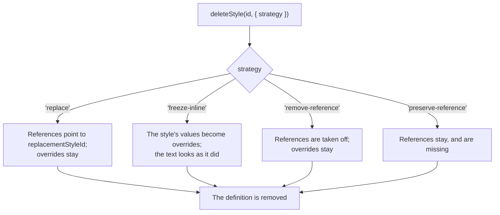

{/* Synced from ueberdosis/tiptap-pro packages/extension-document-styles/docs/cleanup.md. Change it there and sync it again: an edit made here is overwritten by the next sync. */}

```js
editor.commands.deleteStyle('subtitle', { strategy: 'replace', replacementStyleId: 'body' })
```

## Deleting a style

`deleteStyle` removes the definition. Its `strategy` says what happens to the references:



| `strategy`             | What becomes of the references                                                                        |
| ---------------------- | ----------------------------------------------------------------------------------------------------- |
| `'replace'`            | They get `replacementStyleId`. Their overrides stay                                                   |
| `'freeze-inline'`      | They keep how they looked: the style's values become overrides                                        |
| `'remove-reference'`   | They lose the style. Their overrides stay                                                             |
| `'preserve-reference'` | They stay, and are [missing](/editor/extensions/functionality/document-styles/cleanup#missing-styles) |

- **The selection and the rest of the text** stay as they were.
- **One step** of the history.
- **A Mark left with no attribute at all** by `'remove-reference'` is taken off.

`replaceStyle(styleId, replacementStyleId)` points everything at another style and keeps both
definitions. That is Word's "Select all instances" followed by another style. See
[replaceStyle](/editor/extensions/functionality/document-styles/cleanup#replacestyle).

## Missing styles

A reference to an id nothing defines is drawn as if it had no style, and kept. Once something
defines the id, it is drawn by it.

- **`replaceMissingStyles(replacementStyleId)`** points every such reference to a style that
  exists.
- **`removeMissingStyleReferences()`** takes every such reference off, and keeps its overrides.
- **`missingStyleReferences(doc, lookup)`** lists them without changing anything.

## Unused styles

`removeUnusedStyles()` removes the document's own styles nothing refers to.

- **Based on, so used.** A style another one in use is based on counts as used.
- **Defaults are used.** A default style, and the styles it is based on, are kept.
- **A library's styles** are never removed.
- **`unusedStyles(doc, lookup)`** lists them without changing anything, a library's included.

## How styles are used

`analyzeStyleUsage(doc, lookup)` reports every reference in the document:

```js
import { analyzeStyleUsage } from '@tiptap-pro/extension-document-styles'

const doc = editor.state.doc
const report = analyzeStyleUsage(doc, editor.storage.documentStyles.stylesOf(doc))
```

| Field                | Type                | Description                                                                 |
| -------------------- | ------------------- | --------------------------------------------------------------------------- |
| `totalReferences`    | `number`            | Every styled block and run of text                                          |
| `usedStyles`         | `StyleUsage[]`      | Per style: its references, how many are Nodes and Marks, what they override |
| `missingStyles`      | `StyleUsage[]`      | References to an id nothing defines                                         |
| `deprecatedStyles`   | `StyleUsage[]`      | Styles in use that are deprecated                                           |
| `unusedStyles`       | `StyleDefinition[]` | Styles nothing refers to, and no base of a used one                         |
| `overrideReferences` | `StyleReference[]`  | Every reference that overrides something, with a style or without one       |

- **A styled run of text** counts once, however many other Marks run through it.
- **`styleReferencesOf(doc)`** lists every styled block and run of text as a `StyleReference`:
  `from`, `to`, `type`, `kind`, `styleId` and `overrides`.

## Formatting that should be a style

The same overrides, set again and again, are a style nobody defined yet. `discoverStyles` finds
them, most frequent first:

```js
import { discoverStyles } from '@tiptap-pro/extension-document-styles'

const [candidate] = discoverStyles(editor.state.doc, { minOccurrences: 3 })

candidate.props // { fontSize: '18px', fontWeight: 700 }
candidate.references // every place it was found

editor.commands.createStyleFromCandidate(candidate, {
  id: 'lead',
  name: 'Lead',
  applyToMatches: true,
})
```

- **Tiptap's own formatting counts.** Eleven paragraphs colored with `setColor` are one candidate
  with them. See [Tiptap's own formatting](/editor/extensions/functionality/document-styles/values#tiptaps-own-formatting).
- **Values are compared written one way**, so `#1F2937` and `#1f2937` are the same formatting.
- **Order does not matter.** Two sets of overrides are the same where their values are.
- **Blocks and text apart.** A candidate's `targetKind` is `'node'` or `'mark'`.
- **`styleDefinitionOfCandidate(candidate, { id, name })`** turns one into a definition without
  storing it.

| Option               | Type                     | Default                                             | Description                                                                                                                                                       |
| -------------------- | ------------------------ | --------------------------------------------------- | ----------------------------------------------------------------------------------------------------------------------------------------------------------------- |
| `minOccurrences`     | `number`                 | `2`                                                 | How often the same formatting has to occur                                                                                                                        |
| `includeStyledNodes` | `boolean`                | `false`                                             | Also counts formatting on content that already has a style                                                                                                        |
| `kind`               | `StyleKind`              | Guessed by Node type                                | The kind every candidate gets                                                                                                                                     |
| `unstyledBlocks`     | `boolean`                | `false`                                             | Also groups blocks with no style and no formatting. See [Blocks without a style](/editor/extensions/functionality/document-styles/cleanup#blocks-without-a-style) |
| `blockAttributes`    | `string[]`               | `['level']`                                         | The attributes that tell two unstyled blocks of a type apart                                                                                                      |
| `skipUnstyled`       | `(node) => boolean`      | —                                                   | Leaves out the unstyled blocks it answers `true` for                                                                                                              |
| `directFormatting`   | `DirectFormattingRule[]` | `DIRECT_FORMATTING`                                 | How Tiptap's own formatting writes a property                                                                                                                     |
| `markTypes`          | `string[]`               | Every Mark type with a `styleId`, `textStyle` first | The Mark types a character style goes on                                                                                                                          |

To use a style the document already has instead, give it to the candidate:

```js
editor.commands.applyStyleToCandidate(candidate, 'heading-2')
```

## Blocks without a style

A document from somewhere else often has no styles at all: its headings are headings, its
paragraphs paragraphs. `unstyledBlocks` groups the blocks that have neither a style nor overrides,
by Node type and level:

```js
const groups = discoverStyles(doc, { unstyledBlocks: true, minOccurrences: 1 }).filter(
  (candidate) => candidate.node,
)

groups[0].node // { type: 'heading', attrs: { level: 2 } }
groups[0].references.length // 11

editor.commands.applyStyleToCandidate(groups[0], 'heading-2')
```

`skipUnstyled` leaves blocks out, such as those already drawn in their
[default style](/editor/extensions/functionality/document-styles/definitions#the-default-style):

```js
const defaults = editor.storage.documentStyles.defaultStylesOf(doc)

discoverStyles(doc, { unstyledBlocks: true, skipUnstyled: (node) => defaults.of(node) !== null })
```

- **A style made of such a group** with `createStyleFromCandidate` sets nothing, so the blocks
  look as before.
- **Its `node`** is the group's type and attributes. Applying it to another block turns that block
  into, for example, a level 2 heading.

## Writing the defaults onto the blocks

A block drawn in its [default style](/editor/extensions/functionality/document-styles/definitions#the-default-style) names no style, so it
changes when the default does. That happens when a library loaded later has another default for
paragraphs, or a style stops being one. `applyDefaultStyles` writes the default onto those blocks,
which keeps them in it:

```js
editor.storage.documentStyles.defaultStyledBlocksOf(editor.state.doc)
// [{ styleId: 'body', positions: [0, 42, 97] }]

editor.commands.applyDefaultStyles() // every default
editor.commands.applyDefaultStyles('body') // only the blocks drawn in Body Text
```

- **Nothing changes for the reader.** Each block is drawn in the same style, now by its own
  reference, and keeps what it overrides.
- **Only blocks of `types`** are written to.

With `libraries`, the Command writes the defaults those libraries say, rather than the ones the
editor draws. An editor that offers Word's styles without making them the default can give every
paragraph Normal, and every heading its level, that way:

```js
import { wordStyleLibrary } from '@tiptap-pro/extension-document-styles'

editor.commands.applyDefaultStyles(null, { libraries: [wordStyleLibrary()] })
```

- **Here the blocks change for the reader**, since they were drawn in no style before.
- **A default the document cannot draw** is not written: one whose id none of its own styles or
  libraries defines.

## References without an editor

Each of these writes into a Transaction you pass, and returns it:

```js
import {
  replaceStyleReferencesTransaction,
  freezeStyleReferencesTransaction,
  removeStyleReferencesTransaction,
  mapStyleReferencesTransaction,
} from '@tiptap-pro/extension-document-styles'

replaceStyleReferencesTransaction(tr, 'old', 'new')
mapStyleReferencesTransaction(tr, (reference) =>
  reference.styleId === 'old' ? { styleId: 'new', overrides: null } : null,
)
```

| Function                            | Arguments                         | What it writes                                                                    |
| ----------------------------------- | --------------------------------- | --------------------------------------------------------------------------------- |
| `replaceStyleReferencesTransaction` | `tr, styleId, replacementStyleId` | Every reference to a style, pointed at another                                    |
| `freezeStyleReferencesTransaction`  | `tr, styleId, lookup`             | The style's values as overrides, and the reference taken off                      |
| `removeStyleReferencesTransaction`  | `tr, styleId`                     | Every reference to a style taken off                                              |
| `mapStyleReferencesTransaction`     | `tr, change`                      | Each reference as `change` answers it, a `StyleReferenceChange`. `null` leaves it |
| `applyDefaultStylesTransaction`     | `tr, defaults, types, styleId`    | The defaults onto the blocks drawn in them                                        |

- **`defaultStyledBlocks(doc, defaults, types)`** answers the blocks drawn in a default.
- **`defaultStylesWhere(defaults, keep)`** filters defaults, as `applyDefaultStyles` does with
  `libraries`.

## Commands

Every Command is one step of the history.

### deleteStyle

Deletes one of the document's styles, and says what becomes of what refers to it.

```js
editor.commands.deleteStyle('subtitle', { strategy: 'freeze-inline' })
```

| Argument                     | Type     | Description                                                                                       |
| ---------------------------- | -------- | ------------------------------------------------------------------------------------------------- |
| `styleId`                    | `string` | The style                                                                                         |
| `options.strategy`           | `string` | See [Deleting a style](/editor/extensions/functionality/document-styles/cleanup#deleting-a-style) |
| `options.replacementStyleId` | `string` | With `'replace'` only: the style the references get                                               |

Returns `false` for a style that is not the document's own. With `'replace'`, also for a
replacement nothing defines, and for the style itself.

### replaceStyle

Points everything that uses one style at another it fits, keeping both definitions and every
override.

```js
editor.commands.replaceStyle('subtitle', 'heading-2')
```

| Argument             | Type     | Description          |
| -------------------- | -------- | -------------------- |
| `styleId`            | `string` | The style to replace |
| `replacementStyleId` | `string` | The style they get   |

- **A reference the new style does not fit** stays as it is.
- **A paragraph style** replaces block references, not character styles on text.
- **A table style** only goes on a table.
- **A style whose `node` target lists types** only replaces references of those types.
- **With `transformNodeOnApply`**, each block also becomes the style's `node` type, such as a
  heading. A style whose `node` holds blocks, such as a blockquote, sets the reference without
  wrapping anything.

Returns `false` for a replacement nothing defines or that cannot be resolved, for the style
itself, and where nothing it fits uses the style.

### replaceMissingStyles

Points every reference to a style nothing defines at one that exists.

```js
editor.commands.replaceMissingStyles('body')
```

| Argument             | Type     | Description         |
| -------------------- | -------- | ------------------- |
| `replacementStyleId` | `string` | A style that exists |

Returns `false` for a replacement nothing defines, and where no reference is missing.

### removeMissingStyleReferences

Takes every reference to a style nothing defines off, and keeps its overrides.

```js
editor.commands.removeMissingStyleReferences()
```

Returns `false` where no reference is missing.

### removeUnusedStyles

Deletes the document's own styles nothing refers to. See [Unused styles](/editor/extensions/functionality/document-styles/cleanup#unused-styles).

```js
editor.commands.removeUnusedStyles()
```

Returns `false` where every style of the document's own is used.

### applyDefaultStyles

Writes the default style onto every block drawn in it. See
[Writing the defaults onto the blocks](/editor/extensions/functionality/document-styles/cleanup#writing-the-defaults-onto-the-blocks).

```js
editor.commands.applyDefaultStyles('body')
```

| Argument            | Type             | Description                                                        |
| ------------------- | ---------------- | ------------------------------------------------------------------ |
| `styleId`           | `string \| null` | Optional. Only the blocks drawn in this default. Default every one |
| `options.libraries` | `StyleLibrary[]` | Optional. The defaults these libraries say instead of the editor's |

Returns `false` where no block is drawn in a default, or in the one named.

### createStyleFromCandidate

Stores a style made of formatting `discoverStyles` found.

```js
editor.commands.createStyleFromCandidate(candidate, {
  id: 'lead',
  name: 'Lead',
  applyToMatches: true,
})
```

| Argument               | Type             | Description                                                                                            |
| ---------------------- | ---------------- | ------------------------------------------------------------------------------------------------------ |
| `candidate`            | `StyleCandidate` | What `discoverStyles` answered                                                                         |
| `input.id`             | `string`         | The new id                                                                                             |
| `input.name`           | `string`         | The new name                                                                                           |
| `input.applyToMatches` | `boolean`        | Also gives the style to every place that still has that formatting, and takes the formatting off there |

Returns `false` for an id that is taken.

### applyStyleToCandidate

Gives a style the document can use to everything a candidate found, in place of its formatting.

```js
editor.commands.applyStyleToCandidate(candidate, 'heading-2')
```

| Argument    | Type             | Description                    |
| ----------- | ---------------- | ------------------------------ |
| `candidate` | `StyleCandidate` | What `discoverStyles` answered |
| `styleId`   | `string`         | A style that exists            |

A place that was restyled since the candidate was found is left alone. Returns `false` for a style
that cannot be resolved, and where no place still has the formatting.
