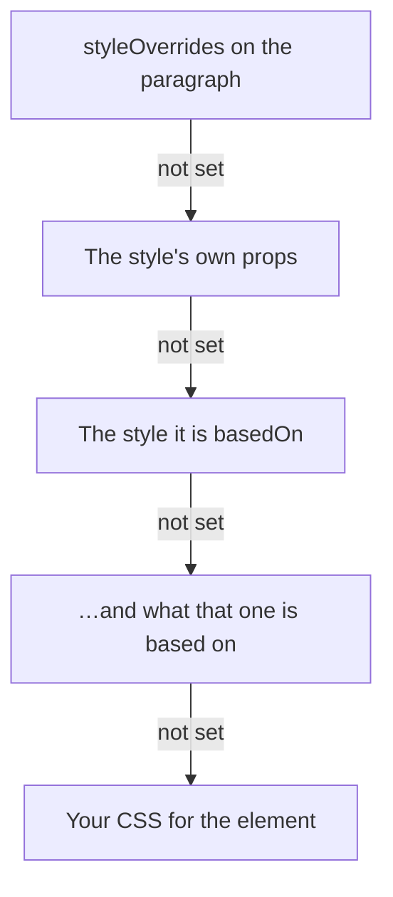

```js
editor.commands.setStyleDefinition({
  id: 'heading-1',
  name: 'Heading 1',
  kind: 'paragraph',
  basedOn: 'body',
  targets: [{ kind: 'node', types: ['heading', 'paragraph'] }],
  node: { type: 'heading', attrs: { level: 1 } },
  props: { fontSize: 32, fontWeight: 700, marginTop: 24 },
})
```

## What a definition holds

`id`, `name` and `kind` are required. Every other field can be left out.

| Field                | Type                                     | Description                                                                                                                                                                            |
| -------------------- | ---------------------------------------- | -------------------------------------------------------------------------------------------------------------------------------------------------------------------------------------- |
| `id`                 | `string`                                 | What content refers to it by. It stays when the style is renamed                                                                                                                       |
| `name`               | `string`                                 | What a reader sees in a style picker                                                                                                                                                   |
| `kind`               | `StyleKind`                              | `'paragraph'`, `'character'`, `'list'`, `'object'`, `'table'`, `'cell'` or `'custom'`. What a picker groups by                                                                         |
| `scope`              | `StyleScope`                             | `'document'`, `'workspace'`, `'organization'` or `'system'`. Where it comes from, as a library labels it                                                                               |
| `basedOn`            | `string`                                 | The style this one inherits every value from that it does not set itself                                                                                                               |
| `nextStyle`          | `string`                                 | The style of the paragraph after this one. See [The next paragraph](/editor/extensions/functionality/document-styles/definitions#the-next-paragraph)                                   |
| `outlineLevel`       | `number \| null`                         | `1` to `9`, its place in the document's outline, or `null` for body text. See [Outline levels](/editor/extensions/functionality/document-styles/definitions#outline-levels)            |
| `defaultFor`         | `StyleDefaultFor[]`                      | Blocks without a style that are drawn in this one. See [The default style](/editor/extensions/functionality/document-styles/definitions#the-default-style)                             |
| `builtIn`            | `WordBuiltInStyle`                       | The one of Word's built-in styles this one is, such as `'heading 1'`. See [Word's built-in styles](/editor/extensions/functionality/document-styles/definitions#words-built-in-styles) |
| `pagination`         | `StylePagination`                        | How a paragraph of this style meets the end of a page. See [Line and page breaks](/editor/extensions/functionality/document-styles/definitions#line-and-page-breaks)                   |
| `language`           | `string \| null`                         | The language of its text, such as `'de-CH'`. See [Language](/editor/extensions/functionality/document-styles/definitions#language)                                                     |
| `priority`           | `number`                                 | Where a style list puts it, the lower first. See [The style list](/editor/extensions/functionality/document-styles/definitions#the-style-list)                                         |
| `hidden`             | `boolean`                                | Left out of a style list until something uses it                                                                                                                                       |
| `gallery`            | `boolean`                                | Among the few a toolbar offers in a row                                                                                                                                                |
| `autoUpdate`         | `boolean`                                | Formatting set on a paragraph of this style changes the style. See [Updating automatically](/editor/extensions/functionality/document-styles/definitions#updating-automatically)       |
| `tableConditions`    | `TableConditions`                        | For a table style: the header row, total row, columns and bands. See [Table styles](/editor/extensions/functionality/document-styles/tables#conditional-formats)                       |
| `tableBands`         | `Partial<TableBands>`                    | For a table style: how many rows and columns one band spans. See [Bands of more than one row](/editor/extensions/functionality/document-styles/tables#bands-of-more-than-one-row)      |
| `targets`            | `StyleTarget[]`                          | Where it can go: `{ kind: 'node', types }` and `{ kind: 'mark', types }`                                                                                                               |
| `node`               | `StyleNodeTransform`                     | The Node type and attributes a block becomes when the style is applied, or the type its blocks are put in                                                                              |
| `props`              | `StyleProps`                             | The values it sets, by CSS property in camel case. See [What a style can set](/editor/extensions/functionality/document-styles/definitions#what-a-style-can-set)                       |
| `meta`               | `Record<string, unknown>`                | Anything of yours, such as the design token a value came from. Kept and never read                                                                                                     |
| `version`            | `number`                                 | Yours to count with                                                                                                                                                                    |
| `status`             | `'draft' \| 'published' \| 'deprecated'` | Where the style is in its life                                                                                                                                                         |
| `replacementStyleId` | `string`                                 | Where a deprecated style points its users                                                                                                                                              |

- **Without `targets`**, a `character` style goes on text and any other kind on the block.
- **`kind` draws nothing.** Two styles that differ only in `kind` look the same.
- **`isStyleDefinition(value)`** tells a definition from something that is not one: it needs an
  `id` that is not empty, a `name` and a `kind`.

## What a style can set

`props` takes any CSS property in camel case, with the value CSS writes for it. A number is a
length in pixels, except for `fontWeight`, `lineHeight` and the other properties CSS reads as a
factor. These are the ones a style for text usually sets:

| What                  | Properties                                                                                                         | Values, for example                                             |
| --------------------- | ------------------------------------------------------------------------------------------------------------------ | --------------------------------------------------------------- |
| Font                  | `fontFamily`, `fontSize`, `fontWeight`, `fontStyle`                                                                | `'theme:minor'`, `16`, `700`, `'italic'`                        |
| Spacing               | `letterSpacing`, `lineHeight`, `marginTop`, `marginBottom`, `textIndent`                                           | `'0.02em'`, `1.15`, `12`, `0`, `24`                             |
| Alignment             | `textAlign`                                                                                                        | `'left'`, `'center'`, `'right'`, `'justify'`                    |
| Case                  | `textTransform`, `fontVariantCaps`                                                                                 | `'uppercase'`, `'small-caps'`, `'all-small-caps'`               |
| Lines                 | `textDecorationLine`, `textDecorationStyle`, `textDecorationColor`, `textDecorationSkipInk`, `textUnderlineOffset` | `'underline'`, `'wavy'`, `'theme:accent2'`, `'none'`, `'0.2em'` |
| Ligatures and numbers | `fontVariantLigatures`, `fontVariantNumeric`                                                                       | `'discretionary-ligatures'`, `'oldstyle-nums tabular-nums'`     |
| Any OpenType feature  | `fontFeatureSettings`                                                                                              | `'"ss01" 1, "swsh" 1'`                                          |
| Trimming a line       | `textBoxTrim`, `textBoxEdge`                                                                                       | `'trim-both'`, `'cap alphabetic'`                               |
| Color                 | `color`, `backgroundColor`                                                                                         | `'#1f2937'`, `'theme:accent1/+40'`                              |

- **A font or a color can be the theme's**, such as `'theme:accent1'`. See [Themes](/editor/extensions/functionality/document-styles/themes).
- **A value that is not written:** one containing `;`, `{`, `}`, `<`, `>`, `\` or `/*`, and a
  name that is not a property in camel case.
- **A property the browser does not know** is written, and the browser ignores it. `textBoxTrim`
  trims a line only in browsers that draw `text-box-trim`.

## Where a value comes from

A value is looked up in three places, and the first that sets it wins:



`resolveStyle(lookup, styleId, overrides)` answers a style with everything it inherits:

```js
import { resolveStyle } from '@tiptap-pro/extension-document-styles'

const styles = editor.storage.documentStyles.stylesOf(editor.state.doc)
const result = resolveStyle(styles, 'heading-1', { color: 'navy' })

if (result.ok) {
  result.style.props // body's values, heading-1's over them, then color: navy
}
```

- **It answers rather than throws.** `result.error.code` is `'missing-style'` for an id nothing
  defines.
- **Styles based on each other** answer `'circular-inheritance'`, with the `chain` that loops.
- **A style that cannot be resolved** has no rule in the stylesheet. What refers to it is drawn as
  if it had no style.
- **`result.style`** also holds the inherited `outlineLevel`, `pagination`, `tableConditions`,
  `tableBands` and `language`.

## The default style

A style with `defaultFor: ['paragraph']` is what every paragraph without a style of its own is
drawn in, as Word's _Normal_ is:

```js
editor.commands.setStyleDefinition({
  id: 'normal',
  name: 'Normal',
  kind: 'paragraph',
  defaultFor: ['paragraph'],
  props: { fontSize: 15, lineHeight: 1.5 },
})
```

- **The paragraphs keep `styleId: null`.** `getJSON()` and `getHTML()` are the same as without a
  default, and changing the default restyles them all at once.
- **In the editor**, such a block carries the default's `data-tt-style-id` and
  `data-tt-style-default`, so CSS can tell it from a block that has the style itself.
- **With `stylesheet: false`**, nothing is drawn, and the defaults are yours to read.

```js
import { styleIdOrDefaultOf } from '@tiptap-pro/extension-document-styles'

const defaults = editor.storage.documentStyles.defaultStylesOf(editor.state.doc)

defaults.of(node) // 'normal' for a paragraph, whatever its own style
styleIdOrDefaultOf(defaults, node) // the Node's own style, or its default
defaults.entries // [{ type: 'paragraph', attrs: {}, styleId: 'normal' }]
```

A default can be for blocks of a type that have certain attributes. That is how each heading
level gets its own, as Word's _Heading 1_ to _Heading 9_ do:

```js
editor.commands.setStyleDefinition({
  id: 'heading-2',
  name: 'Heading 2',
  kind: 'paragraph',
  defaultFor: [{ type: 'heading', attrs: { level: 2 } }],
  props: { fontSize: 21 },
})
```

- **An attribute matches** where the Node's value is the same. A block that changes level is
  drawn in the default of its new one.
- **The more particular default wins.** A default naming more attributes wins over one naming
  fewer, so `defaultFor: ['heading']` draws only the levels nothing names.
- **Between two as particular**, the first wins: the document's own before a library's, unless
  `precedence` is `'libraries'`.
- **A type has to be in `types`** to have a default.
- **A default is never unused.** A default style and the styles it is based on are never
  reported as unused, and `removeUnusedStyles` keeps them.
- **Outline level.** A block drawn in its default keeps the outline level of its Node type.

`defaultStyles(doc, libraries, precedence)` reads the defaults without an editor.

## The next paragraph

Enter at the end of a paragraph whose style has a `nextStyle` gives the new paragraph that
style: after a Heading 1 comes Body Text.

- **No overrides carry over.** The new paragraph starts without the overrides of the one before
  it.
- **With `transformNodeOnApply`**, it also becomes the next style's `node` type, so the paragraph
  after a heading is a paragraph again.
- **Enter in the middle** of a paragraph keeps the style on both halves.
- **A style without `nextStyle`** keeps itself on the new paragraph.
- **Undo** takes back the Enter and the style in one step.
- **`followNextStyle: false`** turns it off.

## Outline levels

`outlineLevel` puts a style's paragraphs in the document's outline, whatever Node type they are.

```js
import { styleOutlineLevelOf } from '@tiptap-pro/extension-document-styles'

const levels = editor.storage.documentStyles.outlineLevelsOf(editor.state.doc)

styleOutlineLevelOf(levels, node) // 2 for a paragraph styled Heading 2
```

- **Inherited** through `basedOn` like a value in `props`. `null` stops it, so a style based on
  a heading can be body text.
- **Out of range.** A level outside `1` to `9` is read as the nearest one.
- **`styleOutlineLevelOf`** answers `null` for a Node whose style is body text. It answers
  `undefined` for one without a style, or with a style nothing defines.
- **A cache key.** `outlineLevelsOf` answers with the same object until a definition changes.
- **Without an editor**, `styleOutlineLevels(doc, libraries, precedence)` reads the same.

[Outline numbering](/editor/extensions/functionality/outline-numbering#numbering-by-style) numbers
paragraphs by these levels.

## Line and page breaks

`pagination` is Word's _Line and Page Breaks_ of a paragraph style:

```js
editor.commands.setStyleDefinition({
  id: 'heading-1',
  name: 'Heading 1',
  kind: 'paragraph',
  pagination: { keepWithNext: true, keepLinesTogether: true },
})
```

| Key                 | Type      | Description                                               |
| ------------------- | --------- | --------------------------------------------------------- |
| `keepWithNext`      | `boolean` | The paragraph stays on the page of the paragraph after it |
| `keepLinesTogether` | `boolean` | The paragraph is not divided between two pages            |
| `pageBreakBefore`   | `boolean` | The paragraph starts a page                               |

- **Inherited key by key** through `basedOn`. `false` stops one a base sets.
- **`resolveStyle`** answers them as `result.style.pagination`.
- **Nothing is drawn.** An editor without pages has no end of a page. They are read where the
  document is laid out on pages.
- **`stylePaginations(doc, libraries, precedence)`** reads every style's, by id.

`styleBlockBreaks({ types, libraries, precedence })` reads them per block, for whatever lays the
document out on pages:

```js
import { styleBlockBreaks } from '@tiptap-pro/extension-document-styles'

const breaksOf = styleBlockBreaks({ types: ['paragraph', 'heading'], libraries: [house] })

breaksOf(node, doc) // { keepWithNext: true, keepTogether: true, pageBreakBefore: false }, or null
```

- **What it reads.** A block's own style, or its type's default.
- **`null`** for a block whose style says nothing about pages, and for a type not in `types`.
- **On pages** it is what `PageLayout` takes as
  [`blockBreaksOf`](/page-layout/extension-behavior/document-styles#line-and-page-breaks).

## Word's built-in styles

`builtIn` names the one of Word's built-in styles a style is, by the name a .docx gives it in
`w:name`. Examples are `'Normal'`, `'heading 1'` to `'heading 9'`, `'Title'`, `'Subtitle'`,
`'Quote'`, `'caption'`, `'toc 1'`, `'Emphasis'`, `'Strong'` and `'Table Grid'`.
`WORD_BUILT_IN_STYLES` lists them all.

```js
editor.commands.setStyleDefinition({
  id: 'chapter',
  name: 'Chapter',
  kind: 'paragraph',
  builtIn: 'heading 1',
})
```

- **One name in every language.** `w:name` is the same wherever Word runs. The name Word shows,
  _Überschrift 1_ in German, is not.
- **Nothing is drawn differently.** It is what a converter reads, in both directions.
- **In Word**, a paragraph of such a style is in the navigation pane and the table of contents,
  as one in Word's own _Heading 1_ would be.
- **Without `builtIn`**, a style is written as a style of its own.
- **Not inherited** through `basedOn`.
- **Two styles with the same `builtIn`.** The first has it, the document's own before a
  library's unless `precedence` is `'libraries'`. The other is a style of its own.
- **A name Word does not build in** is kept, and stands for nothing.

```js
const builtIns = editor.storage.documentStyles.wordBuiltInStylesOf(editor.state.doc)

builtIns.builtInOf('chapter') // 'heading 1': write the style under Word's name
builtIns.styleIdOf('Heading 1') // 'chapter': the style for a paragraph read from a .docx
builtIns.styleIdOf('Title') // null: no style stands for it
```

`styleIdOf` takes a name in any case. `wordBuiltInStyleOf(name)` spells a name the way Word does,
or answers `null` for a name Word does not build in. `wordBuiltInStyles(doc, libraries, precedence)` reads the same without an editor.

## The style list

`priority`, `hidden` and `gallery` order and filter a style list, as Word's do:

| Field      | Word's name         | Description                                                                                   |
| ---------- | ------------------- | --------------------------------------------------------------------------------------------- |
| `priority` | _Recommended_ order | The lower number first. The same priority, and no priority after them, go by name             |
| `hidden`   | _Hide until used_   | Out of the list until a block or text in the document has it, or it is the default of a block |
| `gallery`  | _Quick Styles_      | In the short row a toolbar offers                                                             |

```js
const list = editor.storage.documentStyles.catalogOf(editor.state.doc)
const gallery = editor.storage.documentStyles.catalogOf(editor.state.doc, { gallery: true })
const everything = editor.storage.documentStyles.catalogOf(editor.state.doc, { hidden: true })
```

- **`catalogOf`** answers definitions in that order. `styleCatalog(doc, lookup, options)` does the
  same without an editor.
- **Not inherited.** None of the three fields is, and none changes how anything is drawn.
- **A hidden style** can be applied like any other.
- **The cost.** Finding out whether a hidden style is used reads the document until each one has
  turned up. In a long document, a hidden style nothing uses costs a reading of all of it.

## Updating automatically

With `autoUpdate: true`, `setStyleOverride` on a paragraph of the style writes the value into the
style instead of onto the paragraph. Every paragraph of the style changes with it: Word's
_Automatically update_.

```js
editor.commands.setStyleDefinition({
  id: 'quote',
  name: 'Quote',
  kind: 'paragraph',
  autoUpdate: true,
})
editor.commands.setStyleOverride('color', 'teal') // every quote is teal now
```

- **An override of the same value** on the paragraph is taken off, since the style now says the
  same.
- **Where it holds.** For paragraph styles the document defines, on paragraphs that have the
  style themselves.
- **Where it does not.** A style from a library is read only. A paragraph drawn in a style only
  because it is a default gets an override as before.
- **`unsetStyleOverride` and `clearStyleOverrides`** always act on the paragraph, and leave the
  style as it is.

## Language

`language` gives the text of a style a language, as a BCP 47 tag such as `'en-GB'` or `'de-CH'`.

```js
editor.commands.setStyleDefinition({
  id: 'citation-fr',
  name: 'French quote',
  kind: 'paragraph',
  basedOn: 'quote',
  language: 'fr',
})
```

- **Drawn as `lang`.** A block of the style, and text in a character style, get a `lang`
  attribute. The spell checker, hyphenation and screen readers read it.
- **Inherited** through `basedOn`. `language: null` stops a style inheriting one.
- **Not a language tag?** The value is ignored.
- **Nothing is written into the content.** The attribute follows the style, so changing a
  style's language changes it for every block of it.
- **One language per style.** A .docx stores three per style, for Latin, East Asian and complex
  scripts. `language` is the first.
- **`styleLanguages(doc, libraries, precedence)`** answers the language of each style that has
  one, by id.

## Writing definitions without an editor

The definitions can be read and written on any document of the schema:

```js
import {
  setStyleDefinitionTransaction,
  removeStyleDefinitionTransaction,
  styleDefinitionsOf,
} from '@tiptap-pro/extension-document-styles'

const transaction = setStyleDefinitionTransaction(state.tr, definition)
styleDefinitionsOf(transaction.doc)
```

- **`setStyleDefinitionTransaction`** throws for something that is not a definition. It changes
  only the `styleDefinition` Node of that style.
- **`removeStyleDefinitionTransaction(tr, styleId)`** removes one.
- **The last definition.** A document left without any definition and without a theme loses the
  `styleDefinitions` Node.
- **`styleDefinitionsAt(doc)`** answers the `styleDefinitions` Node and its position, or `null`.

## Commands

Every Command is one step of the history, together with whatever else the Command changed. A
Command that would change a [library's](/editor/extensions/functionality/document-styles/libraries#read-only) style returns `false`.

### setStyleDefinition

Stores a definition in the document, in place of the document's own definition of the same id.

```js
editor.commands.setStyleDefinition({ id: 'body', name: 'Body Text', kind: 'paragraph' })
```

| Argument     | Type              | Description     |
| ------------ | ----------------- | --------------- |
| `definition` | `StyleDefinition` | The whole style |

Returns `false` for something without an `id`, a `name` and a `kind`, for an id a library
defines, and where the document already has that definition.

### renameStyle

Gives one of the document's styles a new name. Its id, and everything that refers to it, stay.

```js
editor.commands.renameStyle('heading-1', 'Chapter')
```

| Argument  | Type     | Description                     |
| --------- | -------- | ------------------------------- |
| `styleId` | `string` | The style                       |
| `name`    | `string` | The new name, trimmed of spaces |

Returns `false` for a style that is not the document's own, and for a name that is empty or the
same.

### duplicateStyle

Copies a style, the document's or a library's, into a new style of the document's own, as a
`draft`.

```js
editor.commands.duplicateStyle('body', 'my-body', 'Body, adjusted')
```

| Argument     | Type     | Description                                                |
| ------------ | -------- | ---------------------------------------------------------- |
| `styleId`    | `string` | The style to copy                                          |
| `newStyleId` | `string` | The id of the copy                                         |
| `name`       | `string` | Optional. Default the original's name with `Copy` after it |

Returns `false` for a style nothing defines, and for a new id that is empty or taken.

### deprecateStyle

Marks one of the document's styles `deprecated`, and points it to a replacement.

```js
editor.commands.deprecateStyle('subtitle', 'heading-2')
```

| Argument             | Type     | Description                         |
| -------------------- | -------- | ----------------------------------- |
| `styleId`            | `string` | The style                           |
| `replacementStyleId` | `string` | Optional. A style that has to exist |

Returns `false` for a style that is not the document's own, for a replacement nothing defines,
and where the style is already deprecated that way.

### updateStyleFromSelection

Writes what the selection overrides into one of the document's styles.

```js
editor.commands.updateStyleFromSelection('body', { removeMatchingOverrides: true })
```

| Argument                          | Type      | Description                                                                          |
| --------------------------------- | --------- | ------------------------------------------------------------------------------------ |
| `styleId`                         | `string`  | The style to update                                                                  |
| `options.removeMatchingOverrides` | `boolean` | Also takes the overrides off the selection, where it has that style. Default `false` |

Returns `false` for a style that is not the document's own, where the selection overrides
nothing, and where the style already says the same.

### createStyleFromSelection

Makes a new style of what the selection overrides, and gives the selection that style.

```js
editor.commands.createStyleFromSelection({ id: 'lead', name: 'Lead', kind: 'paragraph' })
```

| Argument     | Type        | Description                                                             |
| ------------ | ----------- | ----------------------------------------------------------------------- |
| `input.id`   | `string`    | The new id                                                              |
| `input.name` | `string`    | The new name                                                            |
| `input.kind` | `StyleKind` | A `'character'` style goes on the selected text, any other on the block |

Returns `false` for an id that is taken, and for a `'character'` style where there is no Mark
type to put it on.
