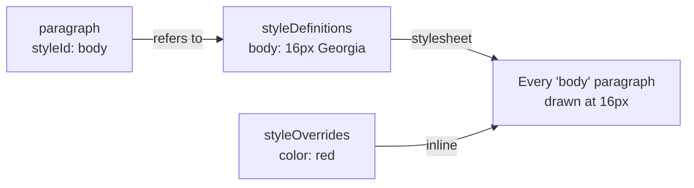

## Install

```bash
npm install @tiptap-pro/extension-document-styles @tiptap/extension-text-style
```

- **The Pro registry.** The package comes from Tiptap's private registry. See
  [The Pro registry](/page-layout/getting-started/install#the-pro-registry)
  to set it up.
- **Peer dependencies.** `@tiptap/core` and `@tiptap/pm`.
- **TextStyle** is the Mark a character style goes on. Without it, styles go on blocks only.
- **Without pages.** The package works in any Tiptap editor, with or without Page Layout.

## Quick start

Add `DocumentStyles` to an editor and apply a style:

```js
import { Editor } from '@tiptap/core'
import StarterKit from '@tiptap/starter-kit'
import { TextStyle } from '@tiptap/extension-text-style'
import { DocumentStyles } from '@tiptap-pro/extension-document-styles'

const editor = new Editor({
  element: document.querySelector('#editor'),
  extensions: [StarterKit, TextStyle, DocumentStyles],
})

editor.commands.applyStyle('heading-1')
```

- **Word's built-in styles come with it.** Normal, No Spacing, Title, Subtitle, Heading 1 to 3,
  Quote, Intense Quote and four character styles. See
  [Word's built-in styles](/editor/extensions/functionality/document-styles/libraries#words-built-in-styles).
- **A paragraph nobody styled** is drawn in Normal, and a heading in the Heading of its level.
- **The styles go on** the `paragraph`, `heading`, `blockquote` and `table` types and on the
  `textStyle` Mark, wherever the schema has them. `types` and `markTypes` choose others.

A style of your own is a definition stored in the document:

```js
editor.commands.setStyleDefinition({
  id: 'body',
  name: 'Body Text',
  kind: 'paragraph',
  props: { fontFamily: 'Georgia, serif', fontSize: 16, lineHeight: 1.6 },
})

editor.commands.applyStyle('body')
```

## What you can do

| Page                                                                           | What it covers                                                                            |
| ------------------------------------------------------------------------------ | ----------------------------------------------------------------------------------------- |
| [Definitions](/editor/extensions/functionality/document-styles/definitions)    | What a style is, what it inherits, and changing one.                                      |
| [Applying styles](/editor/extensions/functionality/document-styles/applying)   | A style on a block or on text, and what one paragraph overrides.                          |
| [Table styles](/editor/extensions/functionality/document-styles/tables)        | A table's header row, total row, first column and bands, and which of them a table shows. |
| [Themes](/editor/extensions/functionality/document-styles/themes)              | Two fonts and twelve colors a style can refer to, and changing them all at once.          |
| [Colors and fonts](/editor/extensions/functionality/document-styles/values)    | Every color and font a document uses, and one replaced by another everywhere.             |
| [Libraries](/editor/extensions/functionality/document-styles/libraries)        | Styles from outside the document, such as a house style or a template.                    |
| [Cleaning up](/editor/extensions/functionality/document-styles/cleanup)        | Deleting a style, missing and unused styles, and finding formatting that should be one.   |
| [Everything at a glance](/editor/extensions/functionality/document-styles/api) | Every option, Command and function, with a link to its page.                              |

## What is stored

Each Node and Mark type listed in `types` and `markTypes` gets two attributes:

| Attribute        | Type                     | Description                                                              |
| ---------------- | ------------------------ | ------------------------------------------------------------------------ |
| `styleId`        | `string \| null`         | The id of its style                                                      |
| `styleOverrides` | `StyleOverrides \| null` | What this one Node or Mark sets apart from its style, `{ color: 'red' }` |

The definitions are stored in the document, in a hidden `styleDefinitions` Node at its end.
`DocumentStyles` adds that Node to the schema.

- **Saved with the document.** `getJSON()` and `getHTML()` carry the definitions, and
  `setContent` brings them back.
- **Undone with the history**, like any other change to the document.
- **Shared** with everyone editing the same document through Tiptap Collaboration.
- **Not on the page.** The Node has nothing to show.

```json
{
  "type": "doc",
  "content": [
    { "type": "paragraph", "attrs": { "styleId": "body", "styleOverrides": null }, "content": [] },
    {
      "type": "styleDefinitions",
      "content": [
        {
          "type": "styleDefinition",
          "attrs": { "definition": { "id": "body", "name": "Body Text", "kind": "paragraph" } }
        }
      ]
    }
  ]
}
```

Each definition is a `styleDefinition` Node of its own. Two people changing two different
styles at the same time both keep their change. `styleDefinitionsContent(definitions, theme)`
builds that JSON for content you put together yourself, such as a document's first content.



## How it is drawn

`DocumentStyles` writes a stylesheet for the editor: one rule per style, selected by the
`data-tt-style-id` attribute on the content. It is rewritten whenever a definition changes.

```html
<p data-tt-style-id="body" data-tt-style-overrides='{"color":"red"}' style="color: red">…</p>
```

- **An override** is written inline on its element and wins over the rule.
- **Scoped to the editor.** The rules are scoped to the editor's own element, which carries
  `data-tt-document-styles`. Two editors on one page with different styles do not draw each
  other's.
- **Your own CSS.** `stylesheet: false` leaves the CSS to you, for example from
  `documentStylesStylesheet`.
- **A block without a style** is drawn in its type's
  [default style](/editor/extensions/functionality/document-styles/definitions#the-default-style), where there is one. In the editor it
  carries `data-tt-style-default` beside the default's id.
- **A character style alone** is written with an empty `style` attribute,
  `<span data-tt-style-id="marker" style="">`. TextStyle reads a `<span>` back only where it has
  one.

How a value becomes CSS:

- **The property.** A value is written as the CSS property it names: `fontSize` as `font-size`,
  `marginTop` as `margin-top`.
- **A number** is in pixels where the property takes a length. It stays as it is for
  `fontWeight`, `lineHeight` and `opacity`.
- **A value that is not plain CSS** is left out, since the definitions come with the document.
  That is a value containing `;`, `{`, `}`, `<`, `>`, `\` or a comment.
- **A theme value** such as `'theme:accent1'` is written as a custom property. See
  [Themes](/editor/extensions/functionality/document-styles/themes).

## Pasting from Word

Text pasted from Word keeps its styles where the document has a style for them. Word writes a
paragraph's style as a class, `class=MsoTitle` or `class=Fazit`, and a heading as `<h1>` to
`<h6>`. Each becomes a reference to:

1. the style whose [`builtIn`](/editor/extensions/functionality/document-styles/definitions#words-built-in-styles) is that style of Word's,
   such as `'Title'` or `'heading 1'`, or else
2. the style whose `name` is the one Word gives it, in any case. That is how a style the author
   made in Word comes back.

- **Word's _Normal_** gets no reference where _Normal_ is the default for paragraphs, as it is
  drawn in it anyway.
- **A style the document has nothing for** is not created. The text arrives with whatever
  formatting the rest of the HTML carries.
- **Character styles** come back on the first Mark type in `markTypes`.
- **The first pasted paragraph** goes into the paragraph at the cursor and keeps that
  paragraph's style. The ones after it keep their own.

`wordStylesToHtml(html, styleIdOf)` is the same rewrite on a string.
`styleIdOfWordNameIn(doc, libraries, precedence)` is the lookup it uses.

## Options

| Option                 | Type                                              | Default                | Description                                                                                                                                                                                  |
| ---------------------- | ------------------------------------------------- | ---------------------- | -------------------------------------------------------------------------------------------------------------------------------------------------------------------------------------------- |
| `types`                | `string[]`                                        | `[]`                   | Node types a style can go on. Left empty: `paragraph`, `heading`, `blockquote` and `table`, those the schema has                                                                             |
| `markTypes`            | `string[]`                                        | `[]`                   | Mark types a character style can go on. `applyStyle` uses the first for a style that names none. Left empty: `textStyle`, if the schema has it                                               |
| `libraries`            | `StyleLibrary[]`                                  | `[]`                   | Read-only sources of styles. See [Libraries](/editor/extensions/functionality/document-styles/libraries)                                                                                     |
| `wordStyles`           | `boolean \| { defaults: boolean }`                | `true`                 | Word's built-in styles under the libraries. See [Word's built-in styles](/editor/extensions/functionality/document-styles/libraries#words-built-in-styles)                                   |
| `precedence`           | `'document' \| 'libraries'`                       | `'document'`           | Whether the document's own definition of an id wins over a library's. See [Which definition wins](/editor/extensions/functionality/document-styles/libraries#which-definition-wins)          |
| `partialSelection`     | `'apply-as-mark' \| 'apply-to-block' \| 'reject'` | `'apply-as-mark'`      | What `applyStyle` does with part of a paragraph. See [A style on a block or on text](/editor/extensions/functionality/document-styles/applying#a-style-on-a-block-or-on-text)                |
| `onMissingStyle`       | `'preserve-reference' \| 'fallback' \| 'remove'`  | `'preserve-reference'` | What `applyStyle` does with an id nothing defines. See [A style nothing defines](/editor/extensions/functionality/document-styles/applying#a-style-nothing-defines)                          |
| `fallbackStyleId`      | `string \| null`                                  | `null`                 | The style `onMissingStyle: 'fallback'` applies instead                                                                                                                                       |
| `transformNodeOnApply` | `boolean`                                         | `false`                | Whether `applyStyle` and `nextStyle` also turn the block into the style's `node` type, and `removeStyle` takes blocks out of a blockquote a style made                                       |
| `stylesheet`           | `boolean`                                         | `true`                 | Whether the editor draws the styles with a stylesheet of its own, a block's default style included                                                                                           |
| `followNextStyle`      | `boolean`                                         | `true`                 | Whether Enter at the end of a paragraph gives the new one the style's `nextStyle`. See [The next paragraph](/editor/extensions/functionality/document-styles/definitions#the-next-paragraph) |
| `repair`               | `boolean`                                         | `true`                 | Whether a second `styleDefinitions` Node is merged into the first. See [Shared styles](/editor/extensions/functionality/document-styles/api#shared-styles)                                   |
| `tableTypes`           | `string[]`                                        | `[]`                   | Table Node types whose parts a table style formats. Left empty: `table`, if `types` has it. See [Table styles](/editor/extensions/functionality/document-styles/tables)                      |
| `continuesNode`        | `((node) => boolean) \| null`                     | `null`                 | Whether a table, or its first row, continues the one before it, where a table is shown in pieces                                                                                             |
| `repeatedRowSelector`  | `string \| null`                                  | `null`                 | The selector of a row drawn as a copy of a table's header row, formatted as the header row                                                                                                   |
| `theme`                | `DocumentTheme \| null`                           | `null`                 | The theme a document without one of its own is drawn in. See [Themes](/editor/extensions/functionality/document-styles/themes)                                                               |
| `colorScheme`          | `ColorScheme`                                     | `'light'`              | `'auto-dark'` or `{ darkSelector }` gives every color a dark counterpart. See [Dark mode](/editor/extensions/functionality/document-styles/themes#dark-mode)                                 |
| `printColorScheme`     | `'light' \| 'screen'`                             | `'light'`              | What print and a PDF get with a dark `colorScheme`                                                                                                                                           |
| `directFormatting`     | `DirectFormattingRule[]`                          | `DIRECT_FORMATTING`    | How Tiptap's own formatting Extensions write a property. See [Tiptap's own formatting](/editor/extensions/functionality/document-styles/values#tiptaps-own-formatting)                       |
| `keepPastedFormatting` | `boolean`                                         | `true`                 | Whether pasted formatting no Extension holds is kept as an override. See [Pasted formatting](/editor/extensions/functionality/document-styles/values#pasted-formatting)                      |

## Reading the styles

`editor.storage.documentStyles` reads what a document can use:

```js
const styles = editor.storage.documentStyles.stylesOf(editor.state.doc)

styles.getStyles() // every style the document can use, its own and its libraries'
styles.getStyle('body') // one, or null
styles.originOf('body') // 'document', 'library' or null
```

Every reader of the storage is listed in [Everything at a glance](/editor/extensions/functionality/document-styles/api#reading-without-commands).

## Limitations

- **No .docx import or export in this package.** A converter reads the definitions with
  `styleDefinitionsOf` and maps them to Word's styles with `wordBuiltInStylesOf`.
- **A paste brings no definitions.** A style the document has nothing for arrives as formatting.
  [`discoverStyles`](/editor/extensions/functionality/document-styles/cleanup#formatting-that-should-be-a-style) can make a style of it
  afterwards.
- **The first pasted paragraph keeps the style of the paragraph at the cursor**, where Word
  would take the pasted one.
- **Tints, shades and dark mode** need a browser that supports `light-dark()` and CSS relative
  colors. See [Themes](/editor/extensions/functionality/document-styles/themes).

What changes on pages: see [Document Styles on pages](/page-layout/other-extensions/document-styles).
