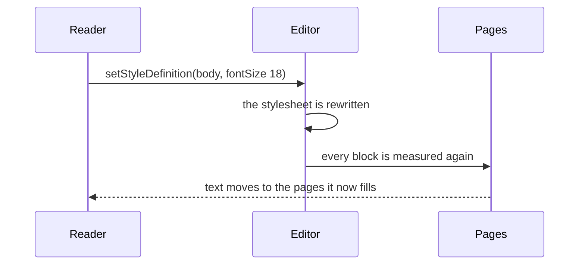

{/* Synced from ueberdosis/tiptap-pro packages/extension-page-layout/docs/other-extensions/document-styles/README.md. Change it there and sync it again: an edit made here is overwritten by the next sync. */}

## Text moves with a style

Make the body style larger, and every paragraph using it is taller. The whole document is laid
out again, as for a change of paper width, and a paragraph that fitted at the bottom of page 4
starts page 5.



- **The definitions** are a block of no height, on no page.
- **A [theme](/editor/extensions/functionality/document-styles/themes)** is kept in the same
  block, so `setDocumentTheme` lays the pages out again as a changed style does. A theme with a
  wider heading font moves the text after every heading.
- **A library change is not a change of the document.** Replacing a library's styles redraws
  them, and the pages are laid out again once the engine is asked to measure:

```js
house.setStyles(next)
editor.storage.pageLayout.engine.refresh()
```

## Reading the styles of the document

In a paginated editor `editor.state` holds the pages, and a paragraph split by a page boundary is
two pieces there. Pass the document itself to the readers:

```js
import { analyzeStyleUsage, discoverStyles } from '@tiptap-pro/extension-document-styles'

const doc = editor.storage.pageLayout.engine.getSourceDocument()
const styles = editor.storage.documentStyles.stylesOf(doc)

analyzeStyleUsage(doc, styles)
discoverStyles(doc)
```

A candidate found this way is what `createStyleFromCandidate` takes.

## Writing styles

- **The Commands need nothing.** They act on the document. A style applied to a paragraph split
  by a page boundary is applied to both halves.
- **On the document.** Following a style's `nextStyle` on Enter, and merging a second block of
  definitions, run on the document. Turning `followNextStyle` or `repair` off turns them off
  there.

Writing the definitions without the Commands goes through the engine, as for every
[Transaction](/page-layout/getting-started/document-and-pages/writing#writing-at-a-position):

```js
import { setStyleDefinitionTransaction } from '@tiptap-pro/extension-document-styles'

const engine = editor.storage.pageLayout.engine
const transaction = setStyleDefinitionTransaction(engine.getSourceState().tr, definition)

engine.applySourceTransaction(transaction, { addToHistory: true })
```

## Line and page breaks

A style's `pagination` is read by the pages only when you pass it on. Give `PageLayout` the
reader Document styles brings, with the types and libraries Document styles is configured with:

```js
import { DocumentStyles, styleBlockBreaks } from '@tiptap-pro/extension-document-styles'
import { PageLayout, pageSetup } from '@tiptap-pro/extension-page-layout'

const types = ['paragraph', 'heading']
const libraries = [house]

DocumentStyles.configure({ types, libraries })
PageLayout.configure({
  setup: pageSetup('A4'),
  blockBreaksOf: styleBlockBreaks({ types, libraries }),
})
```

| In the style        | On the page                                                                  |
| ------------------- | ---------------------------------------------------------------------------- |
| `keepWithNext`      | The paragraph moves to the next page with the first line of the one after it |
| `keepLinesTogether` | The paragraph is not divided between pages                                   |
| `pageBreakBefore`   | The paragraph starts a page                                                  |

- **Without a style of its own**, a paragraph follows its type's default style.
- **`precedence`** is passed to `styleBlockBreaks` as well, where Document styles is configured
  with one.
- **Top-level blocks only.** A paragraph inside a list item breaks as the list does.
- **Changing a style's `pagination`** lays out the pages again, like any change to a definition.
- **When a page keeps them anyway:** see
  [Keeping a block with the next](/page-layout/extension-behavior/your-own-extension/layout-rules#keeping-a-block-with-the-next).
  The field is described in
  [The definition](/editor/extensions/functionality/document-styles/definitions#line-and-page-breaks).

## Table styles across pages

A table style counts a table divided between pages as one. Nothing needs to be configured:
`PageLayout` sets `continuesNode` and `repeatedRowSelector` in the paginated editor.

- **Bands** of the rows on the next page go on from where the page before stopped.
- **The total row** is only on the last page.
- **The header row a table repeats** on every page is drawn in the style's header row format.
- **A row divided between two pages** is one row in its band on both.
- **A change to a table's look**, or to a table style, lays out the pages again, since a bold
  header row can be taller.

See [Table styles](/editor/extensions/functionality/document-styles/tables).
