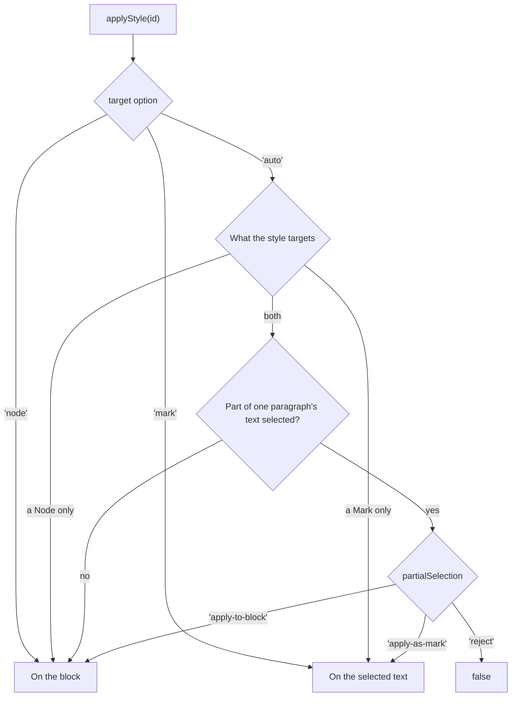

## applyStyle()

```js
editor.commands.applyStyle('heading-1')
editor.commands.applyStyle('heading-1', { target: 'node', transformNode: true })
```

A paragraph style goes on the block the cursor is in, or on every block the selection touches. Of
a quote and the paragraph inside it, it goes on the paragraph, as long as both types are in
`types`. A character style goes on the selected text as a Mark of the first type its `targets`
name, or of the first in `markTypes`; with nothing selected, it goes on the text typed next. The
Mark's other attributes stay, so a `textStyle` that has a color keeps it.

A style whose `targets` name both a Node and a Mark decides by the selection:



| Option          |                                                                                                                                                                                           |
| --------------- | ----------------------------------------------------------------------------------------------------------------------------------------------------------------------------------------- |
| `target`        | `'auto'`, `'node'` or `'mark'`. `'node'` puts a style that can be both on the block, whatever is selected.                                                                                |
| `transformNode` | Also turns each selected text block into the style's `node` type, such as a heading of level 1, or puts the blocks in it where that type holds blocks. `transformNodeOnApply` by default. |

Applying a style takes the block's overrides off: it looks as the style says.

A style put on a block with text selected also takes the character styles off the selected text,
since they would still win over it where they lie. What else such a Mark carries stays, so does
what was overridden on it by hand. With only the cursor in the block, the character styles in it
stay, as in Word.

### A style that wraps its blocks

A style whose `node` is a type that holds blocks, such as `blockquote`, puts the selected blocks
in one of it when `transformNode` is on, and the style goes on that Node. The blocks lose their
own styles and keep their overrides.

```js
{
  id: 'quote',
  name: 'Quote',
  kind: 'paragraph',
  targets: [{ kind: 'node', types: ['blockquote'] }],
  node: { type: 'blockquote' },
  props: { fontStyle: 'italic', paddingLeft: 16 },
}
```

A block style of another `node` applied to a block inside it takes that block out of the
blockquote, which splits the blockquote where the block was in the middle of it. `removeStyle`
takes every block out of it. A blockquote that no style made stays where it is.

`applyStyle` answers `false` where nothing in the selection can carry the style — a type not in
`types`, no Mark type to use — and for a style nobody defines where `onMissingStyle` says so:

| `onMissingStyle`       | An id nothing defines                                              |
| ---------------------- | ------------------------------------------------------------------ |
| `'preserve-reference'` | Is applied all the same, and drawn once something defines it.      |
| `'fallback'`           | Applies `fallbackStyleId` instead, or answers `false` without one. |
| `'remove'`             | Takes the style off the selection.                                 |

## Overrides

What one paragraph sets apart from its style is kept apart from it, so the style can still change
under it:

```js
editor.commands.setStyleOverride('color', '#c00')
editor.commands.unsetStyleOverride('color')
editor.commands.clearStyleOverrides()
```

They act on the style of the selection: on the selected text where part of a paragraph is selected
and it has a styled Mark, on the block otherwise. `unsetStyleOverride` and `clearStyleOverrides`
answer `false` where there is nothing to take off.

## removeStyle()

Takes the style and every override off the selection. With `transformNodeOnApply`, a blockquote
that a style made is removed, and the blocks it held stay in its place.

## clearInlineStyles()

Takes every character style and every override off the selected text, on the Mark types in
`markTypes`, and keeps the block's style. Tiptap's own formatting goes too, as Word's _Clear
character formatting_ takes it: a color from `setColor`, a font from `setFontFamily`, Bold, Italic
and everything else the [`directFormatting` rules](/page-layout/extensions/document-styles/values#tiptaps-own-formatting) know. A Mark
left with nothing is removed; one that carries an attribute of another Extension keeps it, and a
Mark no rule names, such as a link, stays. At the cursor, it acts on the text typed next.

## adoptDirectFormatting()

```js
editor.commands.adoptDirectFormatting()
```

Turns Tiptap's own formatting in the selection into overrides of the style, and the text is drawn
as before: a color from `setColor` and a Bold become `{ color: '#c00000', fontWeight: 700 }` on the
text's `textStyle`, and the Bold Mark comes off. An alignment from `setTextAlign` becomes an
override of the block. At the cursor, it acts on the block the cursor is in.

What changes is that the formatting is in one place, where the theme, [dark mode](/page-layout/extensions/document-styles/themes#dark-mode),
`clearStyleOverrides` and `updateStyleFromSelection` reach it. An override the text already has
for the same property is kept, since it is the one drawn.

Text is given the first of `markTypes`; without one, only blocks are changed. It answers `false`
where the selection has no such formatting. `adoptDirectFormattingTransaction(tr, from, to, { rules, markType })` writes the same into a Transaction of your own.

## expressAsDirectFormatting()

```js
editor.commands.expressAsDirectFormatting()
```

The way back: the overrides in the selection are written as Tiptap's own formatting, and the text
is drawn as before. `{ color: '#c00000', fontWeight: 700 }` becomes Color's attribute on
`textStyle` and a Bold Mark; an alignment override of the block becomes its `textAlign`. Use it
before handing the document to something that knows Tiptap's Marks and nothing of overrides. At
the cursor, it acts on the block the cursor is in.

An override stays one where no rule can write it:

- a theme reference, `theme:accent1`, which Color would not draw;
- a value no Mark stands for, such as `fontWeight: 'normal'` inside a bold style;
- a property whose Mark or attribute the editor does not have.

`textDecorationLine: 'underline line-through'` becomes Underline and Strike. It answers `false`
where nothing can be written. `expressAsDirectFormattingTransaction(tr, from, to, { rules, markTypes })` writes the same into a Transaction of your own.

## detachStyle()

```js
editor.commands.detachStyle({ keepFormatting: true })
```

Takes the style off and keeps how the selection looks: every value the style gave it is written as
an override, so a later change of the style no longer reaches it. Without `keepFormatting`, the
overrides it had are kept and the style's values are gone.

## Reading the style of the selection

What a style picker shows is in the attributes, as for any attribute in Tiptap:

```js
editor.getAttributes('paragraph').styleId
editor.isActive({ styleId: 'heading-1' })
```
