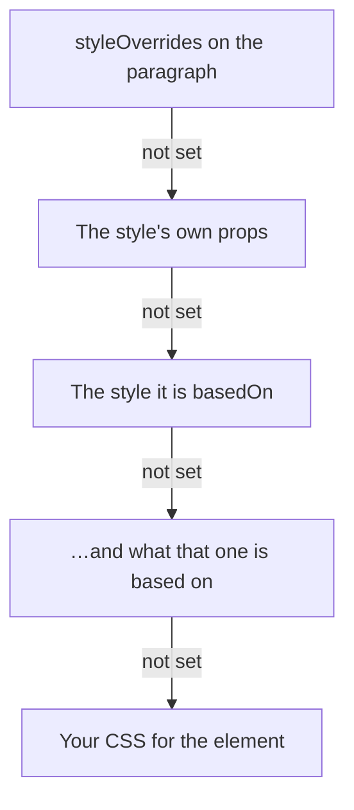

A definition says what a style is called, what it is for, and what it sets:

```js
editor.commands.setStyleDefinition({
  id: 'heading-1',
  name: 'Heading 1',
  kind: 'paragraph',
  basedOn: 'body',
  targets: [{ kind: 'node', types: ['heading', 'paragraph'] }],
  node: { type: 'heading', attrs: { level: 1 } },
  props: { fontSize: 32, fontWeight: 700, marginTop: 24 },
})
```

| Field                           |                                                                                                                                                                                                                                                               |
| ------------------------------- | ------------------------------------------------------------------------------------------------------------------------------------------------------------------------------------------------------------------------------------------------------------- |
| `id`                            | What content refers to it by. It stays when the style is renamed.                                                                                                                                                                                             |
| `name`                          | What a reader sees in a style picker.                                                                                                                                                                                                                         |
| `kind`                          | `'paragraph'`, `'character'`, `'list'`, `'object'`, `'table'`, `'cell'` or `'custom'` — what it is for, which is what a picker groups by.                                                                                                                     |
| `basedOn`                       | The style this one inherits every value from that it does not set itself.                                                                                                                                                                                     |
| `nextStyle`                     | The style the paragraph after this one gets when Enter is pressed at its end; see [The next paragraph](/page-layout/extensions/document-styles/definitions#the-next-paragraph).                                                                               |
| `outlineLevel`                  | `1` to `9`, where a paragraph of this style sits in the document's outline, or `null` for body text; see [Outline levels](/page-layout/extensions/document-styles/definitions#outline-levels).                                                                |
| `defaultFor`                    | Blocks without a style that are drawn in this one: Node types such as `['paragraph']`, or a type with attributes, `{ type: 'heading', attrs: { level: 2 } }`; see [The default style](/page-layout/extensions/document-styles/definitions#the-default-style). |
| `builtIn`                       | The one of Word's built-in styles this one is, such as `'heading 1'`; see [Word's built-in styles](/page-layout/extensions/document-styles/definitions#words-built-in-styles).                                                                                |
| `priority`, `hidden`, `gallery` | Where a style list puts it, whether it waits until something uses it, and whether a gallery offers it; see [The style list](/page-layout/extensions/document-styles/definitions#the-style-list).                                                              |
| `autoUpdate`                    | Formatting set on a paragraph of this style changes the style; see [Updating automatically](/page-layout/extensions/document-styles/definitions#updating-automatically).                                                                                      |
| `language`                      | The language of its text, such as `'de-CH'`, or `null` for none; see [Language](/page-layout/extensions/document-styles/definitions#language).                                                                                                                |
| `tableConditions`               | For a table style, what it formats in the header row, the total row, the first and last column and the bands; see [Table styles](/page-layout/extensions/document-styles/tables).                                                                             |
| `pagination`                    | `{ keepWithNext, keepLinesTogether, pageBreakBefore }`, how a paragraph of this style meets the end of a page; see [Line and page breaks](/page-layout/extensions/document-styles/definitions#line-and-page-breaks).                                          |
| `targets`                       | Where it can go: `{ kind: 'node', types }` and `{ kind: 'mark', types }`. Without targets a `character` style goes on text and any other on the block.                                                                                                        |
| `node`                          | The Node type and attributes the block becomes where `applyStyle` transforms it, or that the blocks are put in where the type holds blocks, such as `blockquote`.                                                                                             |
| `props`                         | The values it sets, by CSS property in camel case. A font or color can be the theme's, `'theme:accent1'`; see [Themes](/page-layout/extensions/document-styles/themes).                                                                                       |
| `meta`                          | Anything of yours, such as the design token a value came from. Kept and never read.                                                                                                                                                                           |
| `version`                       | Yours to count with.                                                                                                                                                                                                                                          |
| `status`                        | `'draft'`, `'published'` or `'deprecated'`.                                                                                                                                                                                                                   |
| `replacementStyleId`            | Where a deprecated style points its users.                                                                                                                                                                                                                    |

`setStyleDefinition` replaces the document's own definition of the same id, and answers `false`
for something without an `id`, a `name` and a `kind`, and for an id a [library](/page-layout/extensions/document-styles/libraries)
defines.

## What a style can set

`props` takes any CSS property in camel case, with the value CSS writes for it. A number is a length
in pixels, except for `fontWeight`, `lineHeight` and the other properties CSS reads as a factor.
These are the ones a style for text usually sets:

| What                  | Properties                                                                                                         | Values, for example                                             |
| --------------------- | ------------------------------------------------------------------------------------------------------------------ | --------------------------------------------------------------- |
| Font                  | `fontFamily`, `fontSize`, `fontWeight`, `fontStyle`                                                                | `'theme:minor'`, `16`, `700`, `'italic'`                        |
| Spacing               | `letterSpacing`, `lineHeight`, `marginTop`, `marginBottom`, `textIndent`                                           | `'0.02em'`, `1.15`, `12`, `0`, `24`                             |
| Alignment             | `textAlign`                                                                                                        | `'left'`, `'center'`, `'right'`, `'justify'`                    |
| Case                  | `textTransform`, `fontVariantCaps`                                                                                 | `'uppercase'`, `'small-caps'`, `'all-small-caps'`               |
| Lines                 | `textDecorationLine`, `textDecorationStyle`, `textDecorationColor`, `textDecorationSkipInk`, `textUnderlineOffset` | `'underline'`, `'wavy'`, `'theme:accent2'`, `'none'`, `'0.2em'` |
| Ligatures and numbers | `fontVariantLigatures`, `fontVariantNumeric`                                                                       | `'discretionary-ligatures'`, `'oldstyle-nums tabular-nums'`     |
| Any OpenType feature  | `fontFeatureSettings`                                                                                              | `'"ss01" 1, "swsh" 1'`                                          |
| Trimming a line       | `textBoxTrim`, `textBoxEdge`                                                                                       | `'trim-both'`, `'cap alphabetic'`                               |
| Color                 | `color`, `backgroundColor`                                                                                         | `'#1f2937'`, `'theme:accent1/+40'`                              |

A value containing `;`, `{`, `}`, `<`, `>`, `\` or `/*` is not written, and neither is a name that
is not a property in camel case. A property the browser does not know is written and ignored by
it: `textBoxTrim` trims a line only in browsers that draw `text-box-trim`.

## Where a value comes from

A value is looked up in three places, and the first that sets it wins:



```js
import { resolveStyle } from '@tiptap-pro/extension-document-styles'

const styles = editor.storage.documentStyles.stylesOf(editor.state.doc)
const result = resolveStyle(styles, 'heading-1', { color: 'navy' })

if (result.ok) {
  result.style.props // body's values, heading-1's over them, then color: navy
}
```

`resolveStyle` answers rather than throws. `result.error.code` is `'missing-style'` for an id
nothing defines, and `'circular-inheritance'` for styles based on each other, with the `chain`
that loops. A style that cannot be resolved has no rule in the stylesheet, and what refers to it is
drawn as if it had no style.

## The default style

A style with `defaultFor: ['paragraph']` is what every paragraph without a style of its own is
drawn in, as Word's _Normal_ is:

```js
editor.commands.setStyleDefinition({
  id: 'normal',
  name: 'Normal',
  kind: 'paragraph',
  defaultFor: ['paragraph'],
  props: { fontSize: 15, lineHeight: 1.5 },
})
```

The paragraphs keep `styleId: null`: `getJSON()` and `getHTML()` are the same as without a
default, and changing the default restyles them all at once. In the editor, such a block carries
the default's `data-tt-style-id` and `data-tt-style-default`, so CSS can tell it from a block that has
the style itself. With `stylesheet: false`, nothing is drawn, and the defaults are yours to read:

```js
import { styleIdOrDefaultOf } from '@tiptap-pro/extension-document-styles'

const defaults = editor.storage.documentStyles.defaultStylesOf(editor.state.doc)

defaults.of(node) // 'normal' for a paragraph, whatever its own style
styleIdOrDefaultOf(defaults, node) // the Node's own style, or its default
defaults.entries // [{ type: 'paragraph', attrs: {}, styleId: 'normal' }]
```

A default can be for blocks of a type that have certain attributes, which is how each heading
level gets its own, as Word's _Heading 1_ to _Heading 9_ are:

```js
editor.commands.setStyleDefinition({
  id: 'heading-2',
  name: 'Heading 2',
  kind: 'paragraph',
  defaultFor: [{ type: 'heading', attrs: { level: 2 } }],
  props: { fontSize: 21 },
})
```

An attribute matches where the Node's value is the same, and a block that changes level is
drawn in the default of its new one. A default naming more attributes wins over one naming fewer,
so a style with `defaultFor: ['heading']` draws only the levels nothing names. Between two as
particular, the first one wins: the document's own before a library's, unless `precedence` is
`'libraries'`. A type has to be in `types` to have a default. A default
style and the styles it is based on are never reported as unused, and `removeUnusedStyles` keeps
them. A block drawn in its default keeps the outline level of its Node type.

## The next paragraph

Enter at the end of a paragraph whose style has a `nextStyle` gives the new paragraph that
style: after a Heading 1 comes Body Text. The new paragraph starts without the overrides of the
one before it. With `transformNodeOnApply`, it also becomes the next style's `node` type, so the
paragraph after a heading is a paragraph again.

Enter in the middle of a paragraph keeps the style on both halves, and so does Enter at the end
of a paragraph whose style has no `nextStyle`. Undo takes back the Enter and the style in one
step. `followNextStyle: false` turns it off.

## Outline levels

`outlineLevel` is inherited through `basedOn` like a value in `props`; `null` stops it, so a style
based on a heading can be body text. A level outside `1` to `9` is read as the nearest one.

A paragraph's level comes from its style, whatever Node type it is:

```js
import { styleOutlineLevelOf } from '@tiptap-pro/extension-document-styles'

const levels = editor.storage.documentStyles.outlineLevelsOf(editor.state.doc)

styleOutlineLevelOf(levels, node) // 2 for a paragraph styled Heading 2
```

It answers `null` for a Node whose style is body text, and `undefined` for one without a style,
or with a style nothing defines.

`outlineLevelsOf` answers with the same object until a definition changes, so it can be
compared or used as a cache key. `styleOutlineLevels(doc, libraries, precedence)` reads the same
in code that holds no editor.

[Outline numbering](/page-layout/extensions/outline-numbering#numbering-by-style) numbers paragraphs by these
levels.

## Line and page breaks

Word's _Line and Page Breaks_ of a paragraph style:

```js
editor.commands.setStyleDefinition({
  id: 'heading-1',
  name: 'Heading 1',
  kind: 'paragraph',
  pagination: { keepWithNext: true, keepLinesTogether: true },
})
```

| Key                 |                                                            |
| ------------------- | ---------------------------------------------------------- |
| `keepWithNext`      | The paragraph stays on the page of the paragraph after it. |
| `keepLinesTogether` | The paragraph is not divided between two pages.            |
| `pageBreakBefore`   | The paragraph starts a page.                               |

Each key is inherited through `basedOn` on its own, and `false` stops one a base sets.
`resolveStyle` answers them as `result.style.pagination`. Nothing about them is drawn: an editor
without pages has no end of a page, and they are read where the document is laid out on pages.

```js
import { styleBlockBreaks } from '@tiptap-pro/extension-document-styles'

const breaksOf = styleBlockBreaks({ types: ['paragraph', 'heading'], libraries: [house] })

breaksOf(node, doc) // { keepWithNext: true, keepTogether: true, pageBreakBefore: false }, or null
```

It reads a block's own style or its type's default, and answers `null` for a block whose style
says nothing about pages. On pages it is what `PageLayout` takes as
[`blockBreaksOf`](/page-layout/extensions/document-styles/on-pages#line-and-page-breaks).

## Word's built-in styles

`builtIn` names the one of Word's built-in styles a style is, by the name a .docx gives it in
`w:name`: `'Normal'`, `'heading 1'` to `'heading 9'`, `'Title'`, `'Subtitle'`, `'Quote'`,
`'caption'`, `'toc 1'`, `'Emphasis'`, `'Strong'`, `'Table Grid'` and the others in
`WORD_BUILT_IN_STYLES`. That name is the same in every language Word runs in; the one Word shows,
_Überschrift 1_ in German, is not.

```js
editor.commands.setStyleDefinition({
  id: 'chapter',
  name: 'Chapter',
  kind: 'paragraph',
  builtIn: 'heading 1',
})
```

Nothing is drawn differently by it. It is what a converter reads, in both directions:

```js
const builtIns = editor.storage.documentStyles.wordBuiltInStylesOf(editor.state.doc)

builtIns.builtInOf('chapter') // 'heading 1': write the style under Word's name
builtIns.styleIdOf('Heading 1') // 'chapter': the style for a paragraph read from a .docx
builtIns.styleIdOf('Title') // null: no style stands for it
```

Word lists a paragraph of such a style in its navigation pane and its table of contents, as a
paragraph in its own _Heading 1_ would be. A style without `builtIn` is written as a style of its
own. `styleIdOf` takes a name in any case, and `wordBuiltInStyleOf(name)` spells it the way Word
does, or answers `null` for a name Word does not build in.

`builtIn` is not inherited through `basedOn`. Where two styles name the same built-in style, the
first one has it, the document's own before a library's unless `precedence` is `'libraries'`, and
the other is a style of its own. A definition with a name Word does not build in is kept, and
stands for nothing.

## The style list

`priority` orders a style list, the lower number first, as Word's _Recommended_ order does. Styles
with the same priority, and every style without one after them, are in the order of their names.

`hidden: true` keeps a style out of the list until a block or a run of text in the document has
it, or it is the default of some blocks: Word's _Hide until used_. `gallery: true` puts a style
into the short row a toolbar offers, Word's _Quick Styles_.

```js
const list = editor.storage.documentStyles.catalogOf(editor.state.doc)
const gallery = editor.storage.documentStyles.catalogOf(editor.state.doc, { gallery: true })
const everything = editor.storage.documentStyles.catalogOf(editor.state.doc, { hidden: true })
```

`catalogOf` answers definitions in that order, and `styleCatalog(doc, lookup, options)` does the
same without an editor. None of the three fields is inherited, and none of them changes how
anything is drawn. A hidden style can be applied like any other.

Finding out whether a hidden style is used reads the document until each one has turned up, so
in a long document a hidden style nothing uses costs a reading of all of it.

## Updating automatically

With `autoUpdate: true`, `setStyleOverride` on a paragraph of the style writes the value into the
style instead of onto the paragraph, so every paragraph of the style changes with it: Word's
_Automatically update_.

```js
editor.commands.setStyleDefinition({
  id: 'quote',
  name: 'Quote',
  kind: 'paragraph',
  autoUpdate: true,
})
editor.commands.setStyleOverride('color', 'teal') // every quote is teal now
```

Where the paragraph already overrode that value, the override is taken off, since the style now
says the same. This holds for paragraph styles the document defines and for paragraphs that have
the style themselves. A style from a library is read only, and a paragraph drawn in a style only
because it is a default gets an override as before. `unsetStyleOverride` and `clearStyleOverrides`
always act on the paragraph.

## Language

`language` gives the text of a style a language, as a BCP 47 tag such as `'en-GB'` or `'de-CH'`.
A block of the style and a run of text in a character style are drawn with a `lang` attribute of
it, which the browser's spell checker and hyphenation read, as does a screen reader.

```js
editor.commands.setStyleDefinition({
  id: 'citation-fr',
  name: 'French quote',
  kind: 'paragraph',
  basedOn: 'quote',
  language: 'fr',
})
```

The language is inherited through `basedOn`, and `language: null` stops a style inheriting one.
A value that is not a language tag is ignored. Nothing is written into the content: the attribute
follows the style, so a style that changes its language changes it for every block of it.
`styleLanguages(doc, libraries, precedence)` answers the language of each style that has one, by
id.

## Changing a style

Every change is one step of the history, together with whatever else the Command changed.

| Command                                                          |                                                                                                                                                                 |
| ---------------------------------------------------------------- | --------------------------------------------------------------------------------------------------------------------------------------------------------------- |
| `renameStyle(styleId, name)`                                     | A new name. The id and everything referring to it stay.                                                                                                         |
| `duplicateStyle(styleId, newStyleId, name?)`                     | A copy under a new id, as a `draft`. Its name is the original's with `Copy` unless you give one.                                                                |
| `deprecateStyle(styleId, replacementStyleId?)`                   | Marks it `deprecated`, pointing to a replacement that has to exist.                                                                                             |
| `updateStyleFromSelection(styleId, { removeMatchingOverrides })` | Writes what the selection overrides into the style. With `removeMatchingOverrides`, the selection's overrides are taken off, since its style now says the same. |
| `createStyleFromSelection({ id, name, kind })`                   | A new style of what the selection overrides, and the selection gets it. A `character` style goes on the selected text.                                          |

Each answers `false` where it would change nothing — the same name, an id that is taken, a style
that is not the document's own — so `editor.can()` tells a toolbar which of them apply:

```js
editor.can().renameStyle('heading-1', 'Title')
```

## In code that holds no editor

The definitions can be read and written on any document of the schema:

```js
import {
  setStyleDefinitionTransaction,
  removeStyleDefinitionTransaction,
  styleDefinitionsOf,
} from '@tiptap-pro/extension-document-styles'

const transaction = setStyleDefinitionTransaction(state.tr, definition)
styleDefinitionsOf(transaction.doc)
```

`setStyleDefinitionTransaction` throws for something that is not a definition, and changes only
the `styleDefinition` Node of that style. A document left without any definition and without a
theme loses the `styleDefinitions` Node.
