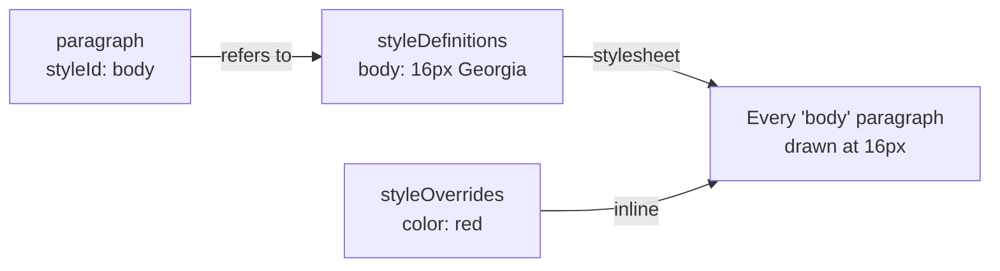

```js
import { Editor } from '@tiptap/core'
import StarterKit from '@tiptap/starter-kit'
import { TextStyle } from '@tiptap/extension-text-style'
import { DocumentStyles } from '@tiptap-pro/extension-document-styles'

const editor = new Editor({
  extensions: [StarterKit, TextStyle, DocumentStyles],
})

editor.commands.applyStyle('heading-1')
```

That is all it takes. Word's built-in styles come with it — Normal, Title, Subtitle, Heading 1 to
3, Quote and four character styles; see [Word's built-in styles](/page-layout/extensions/document-styles/libraries#words-built-in-styles).
A paragraph nobody styled is drawn in Normal and a heading in the Heading of its level, and the
styles go on the `paragraph`, `heading`, `blockquote` and `table` types and on the `textStyle` Mark,
wherever the schema has them.

A style of your own is a definition stored in the document:

```js
editor.commands.setStyleDefinition({
  id: 'body',
  name: 'Body Text',
  kind: 'paragraph',
  props: { fontFamily: 'Georgia, serif', fontSize: 16, lineHeight: 1.6 },
})

editor.commands.applyStyle('body')
```

To choose the types yourself, list them: `types` for the Node types a paragraph style can go on,
`markTypes` for the Mark types a character style can go on. A type the schema does not have is
skipped. `wordStyles: false` leaves Word's styles out.

| Page                                                                  | What it covers                                                                            |
| --------------------------------------------------------------------- | ----------------------------------------------------------------------------------------- |
| [Definitions](/page-layout/extensions/document-styles/definitions)    | What a style is, what it inherits, and changing one.                                      |
| [Applying styles](/page-layout/extensions/document-styles/applying)   | A style on a block or on text, and what one paragraph overrides.                          |
| [Table styles](/page-layout/extensions/document-styles/tables)        | A table's header row, total row, first column and bands, and which of them a table shows. |
| [Themes](/page-layout/extensions/document-styles/themes)              | Two fonts and twelve colors a style can refer to, and changing them all at once.          |
| [Colors and fonts](/page-layout/extensions/document-styles/values)    | Every color and font a document uses, and one replaced by another everywhere.             |
| [Libraries](/page-layout/extensions/document-styles/libraries)        | Styles from outside the document — a house style, a template.                             |
| [Cleaning up](/page-layout/extensions/document-styles/cleanup)        | Deleting a style, missing and unused styles, and finding formatting that should be one.   |
| [Everything at a glance](/page-layout/extensions/document-styles/api) | Every option, command and function on one page.                                           |

## What is stored

Each Node and Mark type listed in `types` and `markTypes` gets two attributes:

- **`styleId`** — the id of its style, or `null`.
- **`styleOverrides`** — the values this one Node or Mark sets apart from its style, such as
  `{ color: 'red' }`, or `null`.

The definitions themselves are stored in the document, in a hidden `styleDefinitions` Node at its
end, which `DocumentStyles` adds to the schema. So they are saved with the document, undone with
the history, and shared with everyone editing the same document through Tiptap Collaboration.
Nothing about them is on the page.

```json
{
  "type": "doc",
  "content": [
    { "type": "paragraph", "attrs": { "styleId": "body", "styleOverrides": null }, "content": [] },
    {
      "type": "styleDefinitions",
      "content": [
        {
          "type": "styleDefinition",
          "attrs": { "definition": { "id": "body", "name": "Body Text", "kind": "paragraph" } }
        }
      ]
    }
  ]
}
```

Each definition is a `styleDefinition` Node of its own, so two people changing two different
styles at the same time both keep their change. `styleDefinitionsContent(definitions, theme)`
builds that JSON for content you put together yourself, such as a document's first content.



## How it is drawn

`DocumentStyles` writes a stylesheet for the editor: one rule per style, selected by the
`data-tt-style-id` attribute the content carries, and rewritten whenever a definition changes. An
override is written inline on its element and wins over the rule.

```html
<p data-tt-style-id="body" data-tt-style-overrides='{"color":"red"}' style="color: red">…</p>
```

The rules are scoped to the editor's own element, which carries `data-tt-document-styles`, so two
editors on one page with different styles do not draw each other's. Set `stylesheet: false` to
write the CSS yourself, for example from `documentStylesStylesheet`.

A block without a style is drawn in its type's [default style](/page-layout/extensions/document-styles/definitions#the-default-style)
where there is one, and carries `data-tt-style-default` in the editor beside the default's id.

A value is written as the CSS property it names: `fontSize` as `font-size`, `marginTop` as
`margin-top`. A number is in pixels where the property takes a length, and as it is for
`fontWeight`, `lineHeight` and `opacity`. A value that is not a plain CSS value — one containing
`;`, `{`, `}`, `<`, `>` or a comment — is left out, since the definitions come with the document.
A value such as `'theme:accent1'` is the theme's, written as a custom property; see
[Themes](/page-layout/extensions/document-styles/themes).

A character style alone is written with an empty `style` attribute, `<span data-tt-style-id="marker" style="">`, because TextStyle reads a `<span>` back only where it has one.

## Pasting from Word

Text pasted from Word keeps its styles where the document has a style of the same kind for them.
Word writes a paragraph's style as a class, `class=MsoTitle` or `class=Fazit`, and a heading as
`<h1>` to `<h6>`; each becomes a reference to:

1. the style whose [`builtIn`](/page-layout/extensions/document-styles/definitions#words-built-in-styles) is that style of Word's, such
   as `'Title'` or `'heading 1'`, or else
2. the style whose `name` is the one Word gives it, in any case — which is how a style the author
   made in Word comes back.

A paragraph in Word's _Normal_ gets no reference where _Normal_ is the default for paragraphs, as
it is drawn in it anyway. A style the document has nothing for is not created: the text arrives
with whatever formatting the rest of the HTML carries. Text styles come back on the first Mark
type in `markTypes`.

The first pasted paragraph goes into the paragraph at the cursor and keeps that paragraph's style;
the ones after it keep their own.

`wordStylesToHtml(html, styleIdOf)` is the same rewrite on a string, and
`styleIdOfWordNameIn(doc, libraries, precedence)` the lookup it uses.

## Options

| Option                 | Default                |                                                                                                                                                                                                                                 |
| ---------------------- | ---------------------- | ------------------------------------------------------------------------------------------------------------------------------------------------------------------------------------------------------------------------------- |
| `types`                | `[]`                   | Node types a style can go on. Left empty: `paragraph`, `heading`, `blockquote` and `table`, those the schema has.                                                                                                               |
| `markTypes`            | `[]`                   | Mark types a character style can go on. The first is the one `applyStyle` uses for a style that names none. Left empty: `textStyle`, if the schema has it.                                                                      |
| `libraries`            | `[]`                   | Read-only sources of styles; see [Libraries](/page-layout/extensions/document-styles/libraries).                                                                                                                                |
| `wordStyles`           | `true`                 | Word's built-in styles under the libraries; `{ defaults: false }` offers them without drawing unstyled blocks in Normal. See [Word's built-in styles](/page-layout/extensions/document-styles/libraries#words-built-in-styles). |
| `precedence`           | `'document'`           | Whether the document's own definition of an id wins over a library's, or `'libraries'`.                                                                                                                                         |
| `partialSelection`     | `'apply-as-mark'`      | What `applyStyle` does with part of a paragraph; see [Applying styles](/page-layout/extensions/document-styles/applying).                                                                                                       |
| `onMissingStyle`       | `'preserve-reference'` | What `applyStyle` does with an id nothing defines.                                                                                                                                                                              |
| `fallbackStyleId`      | `null`                 | The style `onMissingStyle: 'fallback'` applies instead.                                                                                                                                                                         |
| `transformNodeOnApply` | `false`                | Whether `applyStyle` also turns the block into the style's `node` type, and `removeStyle` takes blocks out of a blockquote a style made.                                                                                        |
| `stylesheet`           | `true`                 | Whether the editor draws the styles with a stylesheet of its own, a block's default style included.                                                                                                                             |
| `followNextStyle`      | `true`                 | Whether Enter at the end of a paragraph gives the new one the style's `nextStyle`; see [Definitions](/page-layout/extensions/document-styles/definitions#the-next-paragraph).                                                   |
| `repair`               | `true`                 | Whether a second `styleDefinitions` Node is merged into the first; see [Shared styles](/page-layout/extensions/document-styles/api#shared-styles).                                                                              |
| `tableTypes`           | `[]`                   | Table Node types whose parts a table style formats, each with a `styleLook`; see [Table styles](/page-layout/extensions/document-styles/tables). Left empty: `table`, if `types` has it.                                        |
| `continuesNode`        | `null`                 | Whether a table, or its first row, continues the one before it, where a table is shown in pieces.                                                                                                                               |
| `repeatedRowSelector`  | `null`                 | The selector of a row drawn as a copy of a table's header row, formatted as the header row.                                                                                                                                     |
| `theme`                | `null`                 | The theme a document without one of its own is drawn in; see [Themes](/page-layout/extensions/document-styles/themes).                                                                                                          |
| `colorScheme`          | `'light'`              | `'auto-dark'` or `{ darkSelector }` gives every color a dark counterpart; see [Dark mode](/page-layout/extensions/document-styles/themes#dark-mode).                                                                            |
| `printColorScheme`     | `'light'`              | What print and a PDF get with a dark `colorScheme`: `'light'`, or `'screen'` for the scheme shown.                                                                                                                              |
| `directFormatting`     | `DIRECT_FORMATTING`    | How Tiptap's own formatting Extensions write a property, which the styles read it by; see [Tiptap's own formatting](/page-layout/extensions/document-styles/values#tiptaps-own-formatting).                                     |
| `keepPastedFormatting` | `true`                 | Whether pasted formatting no Extension holds is kept as an override; see [Pasted formatting](/page-layout/extensions/document-styles/values#pasted-formatting).                                                                 |

## Reading the styles

```js
const styles = editor.storage.documentStyles.stylesOf(editor.state.doc)

styles.getStyles() // every style the document can use, its own and its libraries'
styles.getStyle('body') // one, or null
styles.originOf('body') // 'document', 'library' or null
```

## With pages

In an editor with [Page Layout](/page-layout/getting-started/overview), changing a style moves text from page
to page, and the readers on this page take the document from the engine. See
[Document Styles on pages](/page-layout/extensions/document-styles/on-pages).
