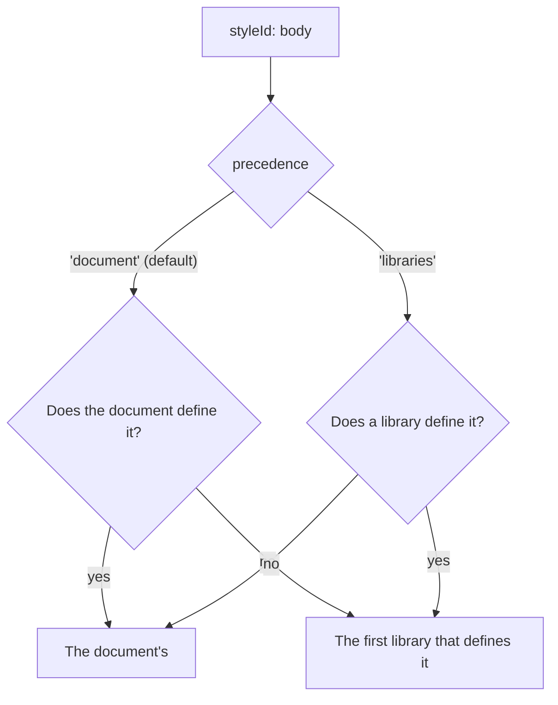

```js
import { DocumentStyles, styleLibrary } from '@tiptap-pro/extension-document-styles'

const house = styleLibrary(
  [{ id: 'body', name: 'House Body', kind: 'paragraph', props: { fontFamily: 'Inter' } }],
  { scope: 'organization' },
)

DocumentStyles.configure({
  types: ['paragraph', 'heading'],
  libraries: [house],
})
```

Replace a library's styles and every editor using it draws them again:

```js
house.setStyles(await fetchHouseStyles())
```

Nothing of a library is stored in the document. A document opened without it keeps its references,
and draws them by whatever else defines those ids, or as [missing](/page-layout/extensions/document-styles/cleanup#missing-styles).

## Word's built-in styles

An editor has the styles a new Word document starts with unless `wordStyles` is `false`. They are
under every library you configure, so a library of yours or the document's own that defines the
same id is the one drawn:

| id                                                          | Name                 | Kind              | On                                                             |
| ----------------------------------------------------------- | -------------------- | ----------------- | -------------------------------------------------------------- |
| `normal`                                                    | Normal               | paragraph         | the default of every paragraph                                 |
| `no-spacing`                                                | No Spacing           | paragraph         |                                                                |
| `title`, `subtitle`                                         | Title, Subtitle      | paragraph, linked |                                                                |
| `heading-1` to `heading-3`                                  | Heading 1 to 3       | paragraph, linked | a heading of that level; the default of headings of that level |
| `quote`, `intense-quote`                                    | Quote, Intense Quote | paragraph         | puts the paragraphs in a blockquote                            |
| `subtle-emphasis`, `emphasis`, `intense-emphasis`, `strong` |                      | character         |                                                                |

A document with no styles of its own is drawn in them: a paragraph in Normal, a heading of the
second level in Heading 2. Their fonts and colors refer to the [theme](/page-layout/extensions/document-styles/themes), and each has the
`builtIn` name a .docx knows it by. A style for a type the editor does not style is left out: the
quotes without `blockquote` in `types`, the character styles without a Mark.

```js
DocumentStyles.configure({
  libraries: [house], // house wins; Word's styles fill in what it does not define
})

DocumentStyles.configure({
  wordStyles: false, // none of Word's styles
})

DocumentStyles.configure({
  wordStyles: { defaults: false }, // to apply, but a paragraph nobody styled stays as it was
})
```

With `defaults: false`, Normal and the headings are no type's default: content that has no styles
keeps the look it had, and Word's styles are there to apply. `wordStyleLibrary({ defaults: false })`
is the same as a library.

`wordStyleLibrary(options)` is the same styles as a library of your own, for types named
differently or to put them somewhere other than last; use it with `wordStyles: false`:

```js
wordStyleLibrary({
  paragraphType: 'paragraph',
  headingType: 'heading',
  quoteType: null,
  markType: 'textStyle',
})
```

`wordStyles(options)` gives the same definitions as an array, and `WORD_STYLES` those for the
default types, to store in a document or to start a library of your own from.

## A library's theme

A library can bring the [theme](/page-layout/extensions/document-styles/themes) its styles are meant to be drawn in, and publish a new
one the same way as new styles:

```js
const house = styleLibrary(houseStyles, {
  scope: 'organization',
  theme: { name: 'House', colors: { accent1: '#536dfe' } },
})

house.setTheme({ name: 'House 2026', colors: { accent1: '#0f766e' } })
```

Its theme is under the document's own and over the `theme` option, font by font and color by
color; with `precedence: 'libraries'` it wins over the document's. Among libraries, the first one's
wins.

## Which definition wins

The same id can be defined by the document and by a library:



With the default, a style changed in one document stays as it was changed when the library is
updated later. With `'libraries'`, the house style wins over a document's own of the same id.

```js
const styles = editor.storage.documentStyles.stylesOf(editor.state.doc)

styles.getStyle('body')?.scope // 'document', or the library's scope
styles.originOf('body') // 'document' or 'library'
```

## Read only

A Command that would change a library's style answers `false`: `setStyleDefinition` with its id,
`renameStyle`, `deprecateStyle`, `updateStyleFromSelection`, `deleteStyle`. A style from a library
can be applied and inherited from like any other, and `duplicateStyle` gives the document a copy
of its own to change:

```js
editor.commands.duplicateStyle('body', 'my-body', 'Body, adjusted')
```

## A library of your own

Anything with `getStyles()` is a library. `getTheme()` is optional, and `subscribe` is how the
editor learns of a change to either:

```js
const library = {
  scope: 'workspace',
  getStyles: () => cache.styles,
  getTheme: () => cache.theme,
  subscribe: (listener) => cache.on('change', listener),
}
```

`subscribe` returns the function that unsubscribes.

Outside an editor, `styleLookupOf(doc, libraries, precedence)` gives the same lookup for any
document of the schema:

```js
import { styleLookupOf } from '@tiptap-pro/extension-document-styles'

styleLookupOf(state.doc, [house]).getStyles()
```
