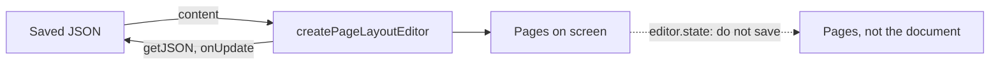

`editor.state` holds what is drawn, the pages, so your own code reads and writes the document
through the engine. This page says where to read, where to write, and when you hear about a change.

## What is stored and what is drawn

- **The document** is what you load and save. `getJSON()`, `getHTML()`, `getText()` and
  `onUpdate` answer for it.
- **The pages** are drawn from the document after every change. `editor.state` holds them.

`editor.state.doc` is not the document. See
[Saving the document](/page-layout/getting-started/existing-editor#saving-the-document).

## Where to read

Read through the engine, `editor.storage.pageLayout.engine`, rather than `editor.state`:

- **The document and its Selection** are `engine.getSourceDocument()` and
  `engine.getSourceState()`.
- **A position you keep**, such as a comment anchor, is a position in the document.
- **The screen** maps to the document with `sourcePositionAtCoords` and `coordsAtSourcePosition`.
- **The pages** are the page map: the page a position is on, and what each page holds.

[Reading the pages](/page-layout/getting-started/document-and-pages/reading) has all of it: positions, the page the cursor is on, the page map
and going to a position.

## Where to write

Your own code that changes the document, such as a table menu, a NodeView or a panel that edits a
Node, writes to the document rather than to the pages:

- **A command** runs with `editor.commands.onSourceDocument(command)`. See
  [Running a command on the document](/page-layout/getting-started/document-and-pages/writing#running-a-command-on-the-document).
- **A Transaction of its own** goes to `engine.dispatchSourceTransaction(tr)`. See
  [A Transaction of your own](/page-layout/getting-started/document-and-pages/writing#a-transaction-of-your-own).
- **A Transaction built on `editor.state` throws** there, and in `applySourceTransaction`. Its
  positions are positions in the pages. Build it on `engine.getSourceState()`.

[Writing to the document](/page-layout/getting-started/document-and-pages/writing) has the rest: writing at a position, going to one, chains of
commands, a table menu, and what happens to an edit made on the pages.

## When you hear about a change

| Event                                    | Emitted                                                                                                                                                                 |
| ---------------------------------------- | ----------------------------------------------------------------------------------------------------------------------------------------------------------------------- |
| `update`                                 | Once for every change to the document, including one a collaborator made. Not when only the pages change: a reflow after a resize, a zoom, a font that finished loading |
| `selectionUpdate`                        | When the cursor or the selection moves in the document                                                                                                                  |
| `transaction`                            | For every change of the editor's state, including the redrawing of the pages after an edit                                                                              |
| `focus`, `blur`                          | As on any editor                                                                                                                                                        |
| `beforeTransaction`, `create`, `destroy` | As on any editor                                                                                                                                                        |

- **The Transaction an `update` or `selectionUpdate` listener receives** is a change to the
  document, so its positions are positions in `getJSON()`.
- **Read the pages in `onChange`.** The `onChange` option of `createPageLayoutEditor` is called
  once the pages are drawn, after every change, including a change of the pages alone. A page
  number read in `update` or `transaction` may still be the one before it. See
  [Where the cursor is](/page-layout/getting-started/document-and-pages/reading#where-the-cursor-is).
