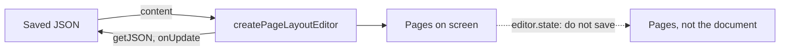

## Installing

`@tiptap-pro/extension-page-layout` comes from Tiptap's registry. Point the project at it once, as
[The Pro registry](/page-layout/getting-started/packages#the-pro-registry) shows. Then:

```bash
npm install @tiptap-pro/extension-page-layout
```

The engine brings no content types of its own. Paragraphs, headings, lists and tables are the
Extensions you already register, such as `@tiptap/starter-kit`. The other packages it works with
are listed in [The packages](/page-layout/getting-started/packages#the-packages).

## A first editor

```js
import { createPageLayoutEditor, PageLayout, pageSetup } from '@tiptap-pro/extension-page-layout'
import StarterKit from '@tiptap/starter-kit'

const editor = createPageLayoutEditor({
  element: document.querySelector('#editor'),
  content: { type: 'doc', content: [{ type: 'paragraph' }] },
  extensions: [StarterKit, PageLayout.configure({ setup: pageSetup('A4') })],
})
```

That is an editor on A4 pages. Go on with [Page format](/page-layout/core-concepts/page-format) for the paper and
the margins, and [Styling the pages](/page-layout/core-concepts/styling) for how the sheets look.

## An editor you already have

Most of a Tiptap integration carries over unchanged: the extensions, the Commands a toolbar calls,
`onUpdate`, `getJSON()`, `setContent()`. What changes is how the editor is built, and anything
that works with a position in the document.

The editor keeps two things apart:

- **The document** is what you load and save. `getJSON()`, `getHTML()`, `getText()` and
  `onUpdate` answer for it.
- **The pages** are drawn from the document on every screen. `editor.state` holds them.



### In short

1. Build the editor with `createPageLayoutEditor` instead of `new Editor`, or with
   `usePageLayoutEditor` instead of `useEditor` in React. See
   [Building the editor](/page-layout/getting-started/install#building-the-editor).
2. Read and write positions through `editor.storage.pageLayout.engine.getSourceState()`. See
   [Positions](/page-layout/getting-started/install#positions).
3. Set up collaboration through the `source` option of `PageLayout`, not as an extension. See
   [Collaboration](/page-layout/getting-started/install#collaboration).

Saving, loading, events, undo and the Commands of a toolbar need no change.

## Building the editor

Pages cannot be added to an editor that already exists. Build it with `createPageLayoutEditor`
instead of `new Editor`, and add `PageLayout` to the extensions:

```js
// Before
import { Editor } from '@tiptap/core'

const editor = new Editor({
  element,
  content,
  extensions: [StarterKit],
  onUpdate: ({ editor }) => save(editor.getJSON()),
})
```

```js
// After
import { createPageLayoutEditor, PageLayout, pageSetup } from '@tiptap-pro/extension-page-layout'

const editor = createPageLayoutEditor({
  element,
  content,
  extensions: [StarterKit, PageLayout.configure({ setup: pageSetup('A4') })],
  onUpdate: ({ editor }) => save(editor.getJSON()),
})
```

It returns a Tiptap `Editor`. It takes these options, and they mean what they mean on
`new Editor` unless the table says otherwise:

| Option                                                                | Description                                                                                                                                 |
| --------------------------------------------------------------------- | ------------------------------------------------------------------------------------------------------------------------------------------- |
| `element`, `content`, `extensions`                                    | Required. `content` is Tiptap JSON                                                                                                          |
| `editable`, `autofocus`                                               | As on any editor                                                                                                                            |
| `injectCSS`, `injectNonce`                                            | As on any editor, and for the page rules too. See [A Content Security Policy](/page-layout/core-concepts/styling#a-content-security-policy) |
| `onBeforeCreate`, `onCreate`, `onDestroy`                             | As on any editor                                                                                                                            |
| `onUpdate`, `onSelectionUpdate`, `onTransaction`, `onFocus`, `onBlur` | See [Events](/page-layout/getting-started/install#events)                                                                                   |
| `onChange`                                                            | Called after every change once the pages are drawn, including a change of the pages alone                                                   |

- **`editorProps` is not accepted.** The editor's `dispatchTransaction` belongs to the pagination.
  The scroll margin is the `scrollMargin` option of `PageLayout`.
- **`PageLayout` in an editor built with `new Editor`** draws no pages, and its Commands return
  `false`. The console says `PageLayout is in an Editor that createPageLayoutEditor did not build`.
- **An editor without an element**, which loads or converts a document without showing it, does
  not warn.

### React

`useEditor` and `EditorContent` from `@tiptap/react` build an editor of their own, so
`@tiptap-pro/extension-page-layout-react` takes their place:

```bash
npm install @tiptap-pro/extension-page-layout-react
```

```jsx
// Before
import { EditorContent, useEditor } from '@tiptap/react'
import StarterKit from '@tiptap/starter-kit'

function MyEditor({ content, onSave }) {
  const editor = useEditor({
    content,
    extensions: [StarterKit],
    onUpdate: ({ editor }) => onSave(editor.getJSON()),
  })

  return <EditorContent editor={editor} />
}
```

```jsx
// After
import { PageLayout, pageSetup } from '@tiptap-pro/extension-page-layout'
import { usePageLayoutEditor } from '@tiptap-pro/extension-page-layout-react'
import StarterKit from '@tiptap/starter-kit'

function MyEditor({ content, onSave }) {
  const { editor, ref, nodeViews } = usePageLayoutEditor({
    content,
    extensions: [StarterKit, PageLayout.configure({ setup: pageSetup('A4') })],
    onUpdate: ({ editor }) => onSave(editor.getJSON()),
  })

  return (
    <>
      {editor && <Toolbar editor={editor} />}
      <div ref={ref} />
      {nodeViews}
    </>
  )
}
```

`usePageLayoutEditor(options, deps)` takes the options of `createPageLayoutEditor` without
`element`, and an optional list of dependencies. It returns:

| Field       | Type                       | Description                                                                               |
| ----------- | -------------------------- | ----------------------------------------------------------------------------------------- |
| `ref`       | `RefCallback<HTMLElement>` | Goes on the element the pages are drawn into                                              |
| `editor`    | `Editor \| null`           | The editor, or `null` until that element is mounted                                       |
| `nodeViews` | `ReactElement`             | The components of the editor's React NodeViews. Render it once, anywhere in the component |

- **Building.** The editor is built once the element is mounted, and destroyed when it is
  unmounted. It is drawn into an element of its own inside the one `ref` is on.
- **Rebuilding.** `content` and `extensions` are read when the editor is built. A change to them
  rebuilds it only when a value in the dependency list changes, as with `useEditor`.
- **Callbacks** are always those of the latest render, so `onUpdate` sees current props.
- **`editable`** is applied without rebuilding the editor.
- **Under `StrictMode`**, the editor built by the first of the two mounts is destroyed, and one
  editor remains.
- **A toolbar** that re-renders on the editor's `transaction` event, as `useEditorState` does,
  stays current.

#### React NodeViews

A Node with `addNodeView() { return ReactNodeViewRenderer(Component) }` works as it does with
`EditorContent`, as long as `nodeViews` is rendered:

- **Where.** The components are rendered where `nodeViews` is, with the React context it has
  there.
- **Without `nodeViews`**, a Node with a React NodeView is drawn empty, and the console says so
  once.
- **A change of height** after drawing lays the pages out again: an image that loads, data that
  arrives, a state of its own.
- **`updateAttributes` and `deleteNode`** change the whole Node, once, from whichever page they are
  called. Both can be undone like an edit of the reader's.
- **Moving to another page** unmounts the component and mounts it again: a Node above it grew, or
  text was added before it. Typing elsewhere does not. Keep state that must survive a move in the
  Node's attributes, or outside the component.
- **A Node a page boundary divides** is rendered by one component per page, and `node` is the part
  on that page.
- **`getPos()`** returns a position in the pages, as dragging the Node and its `selected` prop
  need.

`sourceNodeOfView` returns the Node of the document behind a component, and which part of it the
component draws. `pos` and `node` are the same on every page; see [Positions](/page-layout/getting-started/install#positions).

```jsx
function Callout({ editor, getPos }) {
  const drawn = editor.storage.pageLayout.engine.sourceNodeOfView(getPos())
  // drawn: { pos, node, piece: { index, count } }, or null while the pages are redrawn
  const label =
    drawn && drawn.piece.count > 1 ? `part ${drawn.piece.index + 1} of ${drawn.piece.count}` : null
  // …
}
```

## Saving the document

`getJSON()`, `getHTML()`, `getText()` and `isEmpty` answer for the document the author wrote, so
saving works as before:

```js
const json = editor.getJSON() // the same JSON you would save without pages
const html = editor.getHTML()
```

- **No layout in it.** No page, no half of a paragraph cut at a page boundary and no generated
  break ends up in what they return.
- **`getText()` leaves out the headers and footers.** They are stored in the document but are not
  part of its text.
- **`editor.state.doc` is not the document.** It holds the pages the reader sees, and saving it
  would store them. Read the Node itself from
  `editor.storage.pageLayout.engine.getSourceState().doc`.
- **Loading works as before.** `setContent()` and `clearContent()` replace the document, and the
  pages are laid out again.
- **`setContent(content, { emitUpdate: false })`** replaces it without an `update`.

## Events

| Event                                    | Emitted                                                                                                                                                                 |
| ---------------------------------------- | ----------------------------------------------------------------------------------------------------------------------------------------------------------------------- |
| `update`                                 | Once for every change to the document, including one a collaborator made. Not when only the pages change: a reflow after a resize, a zoom, a font that finished loading |
| `selectionUpdate`                        | When the cursor or the selection moves in the document                                                                                                                  |
| `transaction`                            | For every change of the editor's state, including the redrawing of the pages after an edit                                                                              |
| `focus`, `blur`                          | As on any editor                                                                                                                                                        |
| `beforeTransaction`, `create`, `destroy` | As on any editor                                                                                                                                                        |

The `transaction` an `update` or `selectionUpdate` listener receives is a change to the document,
so its positions are positions in `getJSON()`.

## Positions

Positions in the editor's state are positions in the pages: `editor.state.selection.from`,
`editor.$pos()`, `editor.view.coordsAtPos()`. They differ from positions in the document you save,
and the difference grows with every page. Anything that keeps a position, such as a comment
anchor, a search result or a table of contents, keeps one in the document and asks the engine:

```js
const engine = editor.storage.pageLayout.engine

// Before
const { from, to } = editor.state.selection
const heading = editor.state.doc.nodeAt(pos)

// After
const { from, to } = engine.getSourceState().selection
const heading = engine.getSourceState().doc.nodeAt(pos)
```

Commands that act at the cursor are unaffected: `toggleBold()`, `insertContent()`, `setLink()`,
`toggleBulletList()` and the rest of a toolbar.

### Going to a position

`revealSourcePosition` also draws the page the position is on and scrolls to it:

```js
// Before
editor.commands.setTextSelection(pos)
editor.commands.scrollIntoView()

// After
editor.commands.revealSourcePosition(pos)
```

See [Going to a position](/page-layout/core-concepts/page-numbers#going-to-a-position).

### Writing at a position

Writing at a position is a Transaction on the document:

```js
// Before
editor.view.dispatch(editor.state.tr.insertText('Note: ', pos))

// After
const state = engine.getSourceState()
engine.applySourceTransaction(state.tr.insertText('Note: ', pos), { addToHistory: true })
```

Without `addToHistory: true`, undo does not take the write back.

A write that is a command, or a `...Transaction` function that builds one from a state, runs on the
document as the reader's own edit: undoable, the Selection it sets kept, and scrolled to where the
Transaction asks.

```js
engine.runSourceCommand((state, dispatch) => {
  dispatch?.(state.tr.insertText('Note: ', pos))
  return true
})
```

A component that reads `editor.state` and dispatches on `editor.view`, such as a table menu or a
NodeView, runs its Commands with `editor.commands.onSourceDocument(command)` and its own
Transactions with `engine.dispatchSourceTransaction(tr)`. See
[Components that change the document](/page-layout/getting-started/components). What a toolbar and a status bar read, and
how a button keeps the focus in the editor, is in [A toolbar and a status bar](/page-layout/getting-started/toolbar).

### From the screen to the document and back

The editor view's own readers take and return positions in the pages. The engine has the same four
for positions in the document:

```js
// Before
const hit = editor.view.posAtCoords({ left: event.clientX, top: event.clientY })
const pos = editor.view.posAtDOM(node, offset)
const element = editor.view.nodeDOM(pos)
const rect = editor.view.coordsAtPos(pos)

// After
const hit = engine.sourcePositionAtCoords({ left: event.clientX, top: event.clientY })
const pos = engine.sourcePositionOfDOM(node, offset)
const element = engine.domOfSourceNode(pos)
const rect = engine.coordsAtSourcePosition(pos)
```

| Reader                   | Returns                                                                                                  | `null` for                                                                                              |
| ------------------------ | -------------------------------------------------------------------------------------------------------- | ------------------------------------------------------------------------------------------------------- |
| `sourcePositionAtCoords` | `{ pos, inside }` like `posAtCoords`. `inside` is the Node the point is in, or `-1`                      | A point on nothing of the document: a header or footer, the paper between two pages, outside the editor |
| `sourcePositionOfDOM`    | A position in the document                                                                               | A place in a header or footer, or in an element the editor did not render                               |
| `domOfSourceNode`        | The element, like `nodeDOM`. For a Node a page boundary divides, its first piece on a page that is drawn | A Node with no drawn element                                                                            |
| `domsOfSourceNode`       | Every piece, the first one first                                                                         | Never: an empty array instead                                                                           |
| `coordsAtSourcePosition` | The coordinates, like `coordsAtPos`                                                                      | A position on a page that is not drawn                                                                  |
| `sourceNodeOfView`       | `{ pos, node, piece: { index, count } }` for a position in the pages                                     | A page, a header or a footer                                                                            |

- **While the pages are redrawn** after an edit, they all return `null`, or an empty array.
- **A divided Node** is drawn once per page: a paragraph, table, row or cell a page boundary runs
  through. A divided row has every cell on both pages, and a cell whose text ended above the
  boundary is drawn empty below it.
- **Pages scrolled far out of view are not drawn**, and `domsOfSourceNode` leaves out their
  pieces. `revealSourcePosition(pos)` draws a page and scrolls to it.
- **`side`** works as in `coordsAtPos`, and decides where a page boundary runs through the text:
  `-1`, the default, is the end of the page above, `1` the top of the page below.
- **`sourceNodeOfView`** goes the other way, from a NodeView's `getPos()` or a Node in
  `editor.view.state`. `piece` says which of the Node's pieces is drawn there, and how many there
  are.

```js
for (const piece of engine.domsOfSourceNode(pos)) {
  piece.classList.add('is-highlighted')
}
```

## Undo and redo

- **They undo the author's edits**, never the pagination that followed.
- **They are this package's Commands**, `editor.commands.undo()` and `editor.commands.redo()`. A
  toolbar wired to them is correct.
- **StarterKit's history is taken out of the editor for you**, so there is no other history to
  collide with and nothing else needs to change.
- **`editor.can().undo()` and `editor.can().redo()`** are `false` when there is nothing to undo or
  redo, so a toolbar disables its buttons by them.

In a shared document, see [Undo and redo](/page-layout/guides/collaboration#undo-and-redo) on the
Collaboration page.

## Extensions

- **An extension that adds Nodes, Marks, Commands at the cursor, input rules or keyboard
  shortcuts** works unchanged.
- **An extension that reads the whole document**, such as a table of contents, a numbering or an
  index, sees the pages: a paragraph cut by a page boundary is two Nodes there, and the header
  being edited is a Node too. Pass it `ignoreLayoutArtifacts` to leave those out; see
  [Packages that work without pages](/page-layout/extensions/overview#packages-that-work-without-pages).
- **The Commands an extension brings run on the document**, so a position one of them takes is a
  position in the document; see
  [Commands of your own Extension](/page-layout/guides/custom-nodes#commands-of-your-own-extension).
- **An extension that writes at a position it found itself**, outside a Command, writes as in
  [Writing at a position](/page-layout/getting-started/install#writing-at-a-position).
- **A Node type of your own** moves to the next page whole when it does not fit. A rule that lets a
  page boundary cut through it makes each page render its own part, through your `NodeView` as
  much as through `renderHTML`; see [Custom Node types](/page-layout/guides/custom-nodes).
- **The table extension** is used as you configured it, except that a table renders through its
  `renderHTML`, so a `View` you set on it is not used. Column resizing works if `resizable` is on.

## Collaboration

`@tiptap/extension-collaboration` is replaced by the `source` option of `PageLayout`:

```js
// Before
extensions: [StarterKit, Collaboration.configure({ document: yDoc })]

// After
extensions: [
  StarterKit,
  PageLayout.configure({
    setup: pageSetup('A4'),
    source: createSourceCollaboration({ document: yDoc, awareness: provider.awareness }),
  }),
]
```

`createPageLayoutEditor` throws when the extensions hold `collaboration`, `collaborationCaret` or
`collaborationCursor`, before anything is shown or shared. See
[Collaboration](/page-layout/guides/collaboration).

## Styling

Selectors starting at `.tiptap` still reach the content. The content now sits on sheets whose
width and margins come from the page format. See [Styling the pages](/page-layout/core-concepts/styling) for what
to set instead.

## Commands

### undo

Takes back the last edit to the document.

```js
editor.commands.undo()
```

Returns `false` when there is nothing to undo.

### redo

Applies the last undone edit again.

```js
editor.commands.redo()
```

Returns `false` when there is nothing to redo.
