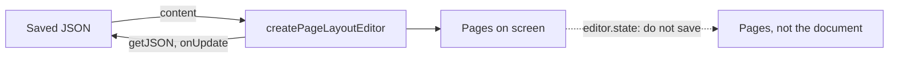

## The document and the pages

- **The document** is what you load and save. `getJSON()`, `getHTML()`, `getText()` and
  `onUpdate` answer for it.
- **The pages** are drawn from the document on every screen. `editor.state` holds them.



The engine, `editor.storage.pageLayout.engine`, reads the document:

```js
const engine = editor.storage.pageLayout.engine

engine.getSourceDocument() // the document's Node
engine.getSourceState() // its state, with the Selection in the document
```

`editor.state.doc` is not the document. See
[Saving the document](/page-layout/getting-started/existing-editor#saving-the-document).

## Events

| Event                                    | Emitted                                                                                                                                                                 |
| ---------------------------------------- | ----------------------------------------------------------------------------------------------------------------------------------------------------------------------- |
| `update`                                 | Once for every change to the document, including one a collaborator made. Not when only the pages change: a reflow after a resize, a zoom, a font that finished loading |
| `selectionUpdate`                        | When the cursor or the selection moves in the document                                                                                                                  |
| `transaction`                            | For every change of the editor's state, including the redrawing of the pages after an edit                                                                              |
| `focus`, `blur`                          | As on any editor                                                                                                                                                        |
| `beforeTransaction`, `create`, `destroy` | As on any editor                                                                                                                                                        |

- **The Transaction an `update` or `selectionUpdate` listener receives** is a change to the
  document, so its positions are positions in `getJSON()`.
- **Read the pages in `onChange`.** The `onChange` option of `createPageLayoutEditor` is called
  once the pages are drawn, after every change, including a change of the pages alone. A page
  number read in `update` or `transaction` may still be the one before it. See
  [Where the cursor is](/page-layout/getting-started/toolbar#where-the-cursor-is).

## Positions

Positions in the editor's state are positions in the pages: `editor.state.selection.from`,
`editor.$pos()`, `editor.view.coordsAtPos()`. They differ from positions in the document you save,
and the difference grows with every page. Anything that keeps a position, such as a comment
anchor, a search result or a table of contents, keeps one in the document and asks the engine:

```js
// Before
const { from, to } = editor.state.selection
const heading = editor.state.doc.nodeAt(pos)

// After
const { from, to } = engine.getSourceState().selection
const heading = engine.getSourceDocument().nodeAt(pos)
```

Commands that act at the cursor are unaffected: `toggleBold()`, `insertContent()`, `setLink()`,
`toggleBulletList()` and the rest of a toolbar.

### Going to a position

`revealSourcePosition` also draws the page the position is on and scrolls to it:

```js
// Before
editor.commands.setTextSelection(pos)
editor.commands.scrollIntoView()

// After
editor.commands.revealSourcePosition(pos)
```

See [Going to a position](/page-layout/features/page-numbers#going-to-a-position).

### Writing at a position

Writing at a position is a Transaction on the document:

```js
// Before
editor.view.dispatch(editor.state.tr.insertText('Note: ', pos))

// After
const state = engine.getSourceState()
engine.applySourceTransaction(state.tr.insertText('Note: ', pos), { addToHistory: true })
```

Without `addToHistory: true`, undo does not take the write back.

A write that is a command, or a `...Transaction` function that builds one from a state, runs on the
document as the reader's own edit: undoable, the Selection it sets kept, and scrolled to where the
Transaction asks.

```js
engine.runSourceCommand((state, dispatch) => {
  dispatch?.(state.tr.insertText('Note: ', pos))
  return true
})
```

A component that reads `editor.state` and dispatches on `editor.view`, such as a table menu or a
NodeView, changes the document in one of two ways:

- **A command** runs with `editor.commands.onSourceDocument(command)`.
- **A Transaction of its own** goes to `engine.dispatchSourceTransaction(tr)`.
- **A Transaction built on `editor.state` throws** there, and in `applySourceTransaction`. Its
  positions are positions in the pages. Build it on `engine.getSourceState()`.

See [Components that change the document](/page-layout/getting-started/components). What a toolbar and a
status bar read, and how a button keeps the focus in the editor, is in
[A toolbar and a status bar](/page-layout/getting-started/toolbar).

### From the screen to the document and back

The editor view's own readers take and return positions in the pages. The engine has the same four
for positions in the document:

```js
// Before
const hit = editor.view.posAtCoords({ left: event.clientX, top: event.clientY })
const pos = editor.view.posAtDOM(node, offset)
const element = editor.view.nodeDOM(pos)
const rect = editor.view.coordsAtPos(pos)

// After
const hit = engine.sourcePositionAtCoords({ left: event.clientX, top: event.clientY })
const pos = engine.sourcePositionOfDOM(node, offset)
const element = engine.domOfSourceNode(pos)
const rect = engine.coordsAtSourcePosition(pos)
```

| Reader                   | Returns                                                                                                  | `null` for                                                                                              |
| ------------------------ | -------------------------------------------------------------------------------------------------------- | ------------------------------------------------------------------------------------------------------- |
| `sourcePositionAtCoords` | `{ pos, inside }` like `posAtCoords`. `inside` is the Node the point is in, or `-1`                      | A point on nothing of the document: a header or footer, the paper between two pages, outside the editor |
| `sourcePositionOfDOM`    | A position in the document                                                                               | A place in a header or footer, or in an element the editor did not render                               |
| `domOfSourceNode`        | The element, like `nodeDOM`. For a Node a page boundary divides, its first piece on a page that is drawn | A Node with no drawn element                                                                            |
| `domsOfSourceNode`       | Every piece, the first one first                                                                         | Never: an empty array instead                                                                           |
| `coordsAtSourcePosition` | The coordinates, like `coordsAtPos`                                                                      | A position on a page that is not drawn                                                                  |
| `sourceNodeOfView`       | `{ pos, node, piece: { index, count } }` for a position in the pages                                     | A page, a header or a footer                                                                            |

- **While the pages are redrawn** after an edit, they all return `null`, or an empty array.
- **A divided Node** is drawn once per page: a paragraph, table, row or cell a page boundary runs
  through. A divided row has every cell on both pages, and a cell whose text ended above the
  boundary is drawn empty below it.
- **Pages scrolled far out of view are not drawn**, and `domsOfSourceNode` leaves out their
  pieces. `revealSourcePosition(pos)` draws a page and scrolls to it.
- **`side`** works as in `coordsAtPos`, and decides where a page boundary runs through the text:
  `-1`, the default, is the end of the page above, `1` the top of the page below.
- **`sourceNodeOfView`** goes the other way, from a NodeView's `getPos()` or a Node in
  `editor.view.state`. `piece` says which of the Node's pieces is drawn there, and how many there
  are.

```js
for (const piece of engine.domsOfSourceNode(pos)) {
  piece.classList.add('is-highlighted')
}
```

## editor.state as the document

The experimental `experimentalSourceState` option makes `editor.state` hold the document rather
than the pages, so code written for an editor without pages reads it unchanged. See
[editor.state as the document](/page-layout/getting-started/components#editorstate-as-the-document).
