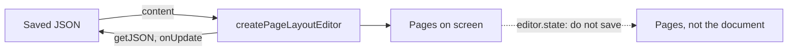

## Where to read

- **The document** is what you load and save. `getJSON()`, `getHTML()`, `getText()` and
  `onUpdate` answer for it.
- **The pages** are drawn from the document on every screen. `editor.state` holds them.



The engine, `editor.storage.pageLayout.engine`, reads the document:

```js
const engine = editor.storage.pageLayout.engine

engine.getSourceDocument() // the document's Node
engine.getSourceState() // its state, with the Selection in the document
```

`editor.state.doc` is not the document. See
[Saving the document](/page-layout/getting-started/existing-editor#saving-the-document).

### Positions

Positions in the editor's state are positions in the pages: `editor.state.selection.from`,
`editor.$pos()`, `editor.view.coordsAtPos()`. They differ from positions in the document you save,
and the difference grows with every page. Anything that keeps a position, such as a comment
anchor, a search result or a table of contents, keeps one in the document and asks the engine:

```js
// Before
const { from, to } = editor.state.selection
const heading = editor.state.doc.nodeAt(pos)

// After
const { from, to } = engine.getSourceState().selection
const heading = engine.getSourceDocument().nodeAt(pos)
```

Commands that act at the cursor are unaffected: `toggleBold()`, `insertContent()`, `setLink()`,
`toggleBulletList()` and the rest of a toolbar.

### From the screen to the document and back

The editor view's own readers take and return positions in the pages. The engine has the same four
for positions in the document:

```js
// Before
const hit = editor.view.posAtCoords({ left: event.clientX, top: event.clientY })
const pos = editor.view.posAtDOM(node, offset)
const element = editor.view.nodeDOM(pos)
const rect = editor.view.coordsAtPos(pos)

// After
const hit = engine.sourcePositionAtCoords({ left: event.clientX, top: event.clientY })
const pos = engine.sourcePositionOfDOM(node, offset)
const element = engine.domOfSourceNode(pos)
const rect = engine.coordsAtSourcePosition(pos)
```

| Reader                   | Returns                                                                                                  | `null` for                                                                                              |
| ------------------------ | -------------------------------------------------------------------------------------------------------- | ------------------------------------------------------------------------------------------------------- |
| `sourcePositionAtCoords` | `{ pos, inside }` like `posAtCoords`. `inside` is the Node the point is in, or `-1`                      | A point on nothing of the document: a header or footer, the paper between two pages, outside the editor |
| `sourcePositionOfDOM`    | A position in the document                                                                               | A place in a header or footer, or in an element the editor did not render                               |
| `domOfSourceNode`        | The element, like `nodeDOM`. For a Node a page boundary divides, its first piece on a page that is drawn | A Node with no drawn element                                                                            |
| `domsOfSourceNode`       | Every piece, the first one first                                                                         | Never: an empty array instead                                                                           |
| `coordsAtSourcePosition` | The coordinates, like `coordsAtPos`                                                                      | A position on a page that is not drawn                                                                  |
| `sourceNodeOfView`       | `{ pos, node, piece: { index, count } }` for a position in the pages                                     | A page, a header or a footer                                                                            |

- **While the pages are redrawn** after an edit, they all return `null`, or an empty array.
- **A divided Node** is drawn once per page: a paragraph, table, row or cell a page boundary runs
  through. A divided row has every cell on both pages, and a cell whose text ended above the
  boundary is drawn empty below it.
- **Pages scrolled far out of view are not drawn**, and `domsOfSourceNode` leaves out their
  pieces. `revealSourcePosition(pos)` draws a page and scrolls to it.
- **`side`** works as in `coordsAtPos`, and decides where a page boundary runs through the text:
  `-1`, the default, is the end of the page above, `1` the top of the page below.
- **`sourceNodeOfView`** goes the other way, from a NodeView's `getPos()` or a Node in
  `editor.view.state`. `piece` says which of the Node's pieces is drawn there, and how many there
  are.

```js
for (const piece of engine.domsOfSourceNode(pos)) {
  piece.classList.add('is-highlighted')
}
```

### Where the cursor is

A status bar reads the page the cursor is on, its section, and the header or footer being edited:

```js
engine.getActivePageIndex() // the page the cursor is on, counting from 0, or the one whose header or footer is open
engine.getPageCount()
engine.getActiveSectionIndex() // its section, or the one whose header or footer is open
engine.getFurnitureTarget() // the header or footer being edited, or null
engine.getTableContext() // the table and row at the cursor, or null
```

- **Read a status bar in `onChange`.** The pages are laid out again after a change, so a page
  number read during the `transaction` event may still be the one before it. The `onChange` option
  of `createPageLayoutEditor` is called once they are drawn.
- **Read again after a change.** Every number these return is true of the layout it was read from.
  Do not keep it.

```js
const editor = createPageLayoutEditor({
  element,
  content,
  extensions: [StarterKit, PageLayout.configure({ setup: pageSetup('A4') })],
  onChange: (editor) => {
    const engine = editor.storage.pageLayout.engine
    status.textContent = `Page ${engine.getActivePageIndex() + 1} of ${engine.getPageCount()}`
  },
})
```

What a toolbar's buttons read is in [A toolbar](/page-layout/reference/commands#a-toolbar).

## Where to write

Your own code that changes the document, such as a table menu, a NodeView or a panel that edits a
Node, writes to the document rather than to the pages:

- **A command** runs with `editor.commands.onSourceDocument(command)`. See
  [Running a command on the document](/page-layout/getting-started/the-document-and-the-pages#running-a-command-on-the-document).
- **A Transaction of its own** goes to `engine.dispatchSourceTransaction(tr)`. See
  [A Transaction of your own](/page-layout/getting-started/the-document-and-the-pages#a-transaction-of-your-own).
- **A Transaction built on `editor.state` throws** there, and in `applySourceTransaction`. Its
  positions are positions in the pages. Build it on `engine.getSourceState()`.

### Why editor.state is the wrong place

Code written for an editor without pages usually reads `editor.state` and dispatches on
`editor.view`. In an editor on pages, `editor.state` holds the pages:

- **A table that runs over a page boundary** is a table per page there, each with only the rows of
  its page.
- **A paragraph cut by the boundary** is two paragraphs.

A change worked out from that is worked out from the wrong table.

### Running a command on the document

Any command of the form `(state, dispatch) => boolean` runs on the document through
`onSourceDocument`:

```js
import { addColumnAfter } from '@tiptap/pm/tables'

editor.commands.onSourceDocument(addColumnAfter)
```

- **It reads the document and its cursor.** A cell that spans rows over a page boundary is one
  cell, and a table has all its rows.
- **It is the reader's own edit.** It can be undone, the Selection it sets is kept, and the page
  is scrolled to where the Transaction asks.
- **The pages are drawn again** before the call returns.
- **`editor.can().onSourceDocument(command)`** asks the document as well, so a menu disables an
  item by it.

### A Transaction of your own

Build it on `engine.getSourceState()` and hand it to `dispatchSourceTransaction`:

```js
const engine = editor.storage.pageLayout.engine
const state = engine.getSourceState()

engine.dispatchSourceTransaction(state.tr.insertText('Note: ', state.selection.from))
```

- **It is applied as `onSourceDocument` applies a command.** It can be undone, its Selection is
  kept, and the pages are drawn again before it returns.
- **It returns `false`** when the editor has been destroyed.
- **Read the state, build the Transaction and dispatch it in one go.** A state kept across an
  `await` is out of date by the time it is used.
- **`applySourceTransaction`** is for changes that are not the reader's. It leaves the undo history
  alone unless asked, and keeps the reader's Selection where it was.

Both throw for a Transaction built on any other state:

- **Built on `editor.state`.** It holds positions in the pages, which mean something else in the
  document.
- **Built on a state read before another change.** It would apply its steps where the text has
  moved since.

The error says which of the two it was:

```txt
[page-layout] dispatchSourceTransaction takes a Transaction built on engine.getSourceState(),
and this one was built on editor.state, which holds the pages rather than the document. Build it
again from engine.getSourceState().tr.
```

### Writing at a position

Writing at a position is a Transaction on the document:

```js
// Before
editor.view.dispatch(editor.state.tr.insertText('Note: ', pos))

// After
const state = engine.getSourceState()
engine.applySourceTransaction(state.tr.insertText('Note: ', pos), { addToHistory: true })
```

Without `addToHistory: true`, undo does not take the write back.

A write that is a command, or a `...Transaction` function that builds one from a state, runs on the
document as the reader's own edit: undoable, the Selection it sets kept, and scrolled to where the
Transaction asks.

```js
engine.runSourceCommand((state, dispatch) => {
  dispatch?.(state.tr.insertText('Note: ', pos))
  return true
})
```

### Going to a position

`revealSourcePosition` also draws the page the position is on and scrolls to it:

```js
// Before
editor.commands.setTextSelection(pos)
editor.commands.scrollIntoView()

// After
editor.commands.revealSourcePosition(pos)
```

See [Going to a position](/page-layout/features/page-numbers#going-to-a-position).

### Combining commands in a chain

An extension's Commands run on the document. Tiptap's core Commands, such as `insertContent`, run
on the pages. A chain can mix the two:

```js
editor.chain().goToNextCell().insertContent('X').run()
```

- **The editor writes `X` into the next cell.** A core Command in the chain still reads an explicit
  position as a position in the pages.
- **Undo may take more than one step.** Each run of document Commands and each run of core
  Commands is committed on its own.
- **During IME composition**, a chain that goes from a document Command to a core Command returns
  `false` before the core Command writes. The document Command is already committed. Run the core
  Command after composition ends.
- **In a custom callback**, finish writing to a captured `tr` before you call a Command of the
  other kind. Changing content, the Selection or stored marks through that `tr` afterwards makes
  `run()` return `false`. What the chain committed before stays in the document.

Only `editor.chain()`, and the same chain under `can()`, work this way. Inside
`editor.commands.command(...)` or `editor.commands.first(...)`, a core Command that follows a
document Command writes nothing, although the call returns `true`. Use a chain for that sequence:

```js
editor.chain().goToNextCell().insertContent('X').run() // writes X
editor.commands.command(({ commands }) => commands.goToNextCell() && commands.insertContent('X')) // does not
```

### Example: a table menu

What a menu needs to know about the table at the cursor, and an action on it:

```js
import { addColumnAfter, deleteRow, findTable, TableMap } from '@tiptap/pm/tables'

const engine = editor.storage.pageLayout.engine

function tableAtCursor() {
  const state = engine.getSourceState()
  const table = findTable(state.selection.$from)

  return table && { ...table, map: TableMap.get(table.node) }
}

// Columns and rows of the whole table, not of the part on this page
const table = tableAtCursor()
const columns = table?.map.width
const rows = table?.map.height

// Menu items
const canDeleteRow = editor.can().onSourceDocument(deleteRow)
editor.commands.onSourceDocument(addColumnAfter)

// Write into the first cell, inside its first paragraph
const state = engine.getSourceState()
const { start, map } = tableAtCursor()
engine.dispatchSourceTransaction(state.tr.insertText('Total', start + map.map[0] + 2))
```

`tableAtCursor()` is read again before the Transaction, because the command before it changed the
document. `map.map` holds positions, which are valid only for the document they were read from.

### What happens to an edit made on the pages

An edit dispatched on `editor.view` still reaches the document where it can be applied there:
typing, deleting, pasting, a mark, an attribute on one Node. Two kinds are refused, and change
nothing:

- **An edit that would leave a table inconsistent**, such as a column added to the rows of one page
  only. See [Nodes that must stay consistent](/page-layout/other-extensions/your-own-extension#nodes-that-must-stay-consistent).
- **An edit that would put a page into the document.**

The console says so once per kind, and names `getSourceState()` and `dispatchSourceTransaction`.
The Commands this package and the table extension put on `editor.commands` already run on the
document, and are not affected.

### A command the pages could not carry

A command that builds its change from what is drawn on one page, rather than from the document, can
write something the editor cannot carry back. The `onCommandOnPages` option of `PageLayout` is told
when that happens, with the command's name, which is how such a command is found. See
[Options](/page-layout/reference/options#the-document).

### editor.state as the document

Experimental, and off by default:

```js
PageLayout.configure({ setup: pageSetup('A4'), experimentalSourceState: true })
```

`editor.state` then holds the document, so code written for an editor without pages works on it
unchanged:

- **Tiptap's own Commands run on the document.** A position handed to `setTextSelection`,
  `insertContentAt` or `deleteRange` is a position in the document.
- **`editor.view.dispatch(editor.state.tr.insertText('Note: '))`** changes the document, as the
  reader's own edit.
- **`isActive()` and `getAttributes()`** answer for the document, so a paragraph cut by a page
  boundary is one paragraph.
- **`editor.view.state` still holds the pages.** A position read off `editor.state` is wrong when
  passed to the editor view, such as `editor.view.coordsAtPos()`, `domAtPos()` or `nodeDOM()`, or
  to `editor.$pos()`. Use the engine's readers instead. See
  [From the screen to the document and back](/page-layout/getting-started/the-document-and-the-pages#from-the-screen-to-the-document-and-back).

## When you hear about a change

| Event                                    | Emitted                                                                                                                                                                 |
| ---------------------------------------- | ----------------------------------------------------------------------------------------------------------------------------------------------------------------------- |
| `update`                                 | Once for every change to the document, including one a collaborator made. Not when only the pages change: a reflow after a resize, a zoom, a font that finished loading |
| `selectionUpdate`                        | When the cursor or the selection moves in the document                                                                                                                  |
| `transaction`                            | For every change of the editor's state, including the redrawing of the pages after an edit                                                                              |
| `focus`, `blur`                          | As on any editor                                                                                                                                                        |
| `beforeTransaction`, `create`, `destroy` | As on any editor                                                                                                                                                        |

- **The Transaction an `update` or `selectionUpdate` listener receives** is a change to the
  document, so its positions are positions in `getJSON()`.
- **Read the pages in `onChange`.** The `onChange` option of `createPageLayoutEditor` is called
  once the pages are drawn, after every change, including a change of the pages alone. A page
  number read in `update` or `transaction` may still be the one before it. See
  [Where the cursor is](/page-layout/getting-started/the-document-and-the-pages#where-the-cursor-is).

## Commands

### onSourceDocument

Runs a command written for an editor view on the document rather than on the pages, as the
reader's own edit.

```js
editor.commands.onSourceDocument(addColumnAfter)
```

| Option    | Type                                 | Description                  |
| --------- | ------------------------------------ | ---------------------------- |
| `command` | `(state, dispatch, view) => boolean` | A ProseMirror command to run |

Returns `false` when the command returns `false` on the document, and when the editor was not
built by `createPageLayoutEditor`.
